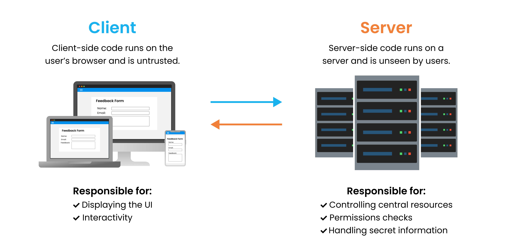
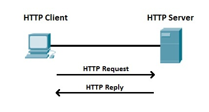
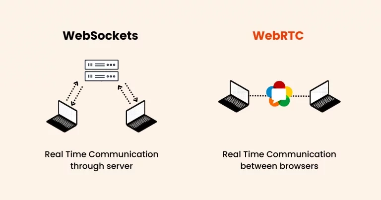
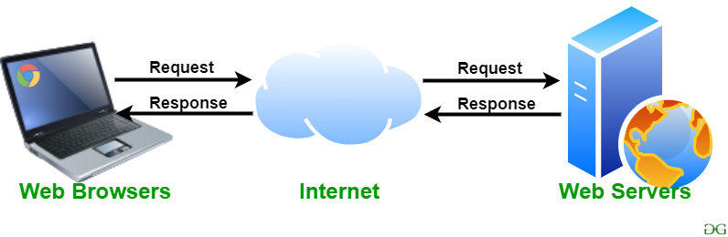

## Learning Objectives

By the end of this lecture, students should be able to:

- Explain the difference between the Internet and the World Wide Web.
- Describe how a browser communicates with a web server.
- Identify the main technologies involved in front-end and back-end development.
- Recognize the purpose of common web protocols.
- Read the basic structure of an HTTP request and response.
- Explain common HTTP methods and status codes.

## What Is the Web?

The **Internet** is the global network that connects computers, phones, servers, and other devices. The **World Wide Web**, often shortened to *the Web*, is one of the services that operates on top of the Internet. It allows people to access connected pages and applications through web browsers.

When we open a news website, watch a video, read an online article, or use a shopping application, we are using the Web. A web page may contain text, images, audio, video, forms, and interactive components. These resources are connected through links and are delivered to the browser over a network.

The Web was proposed by **Tim Berners-Lee** at CERN in 1989 as a way for researchers to share information. The first website became available in 1991. Since then, the Web has evolved from mostly static documents into interactive applications used for communication, education, entertainment, commerce, and many other activities.

It is useful to distinguish the Web from the Internet: the Internet provides the network infrastructure, while the Web uses that infrastructure to deliver websites and web applications. Email, file transfer, and other services also use the Internet, but they are not themselves the World Wide Web.

## How a Website Works

A typical web interaction involves two main participants: a **client** and a **server**. The client is usually a web browser running on a user's device. The server is a computer or software system that receives requests and sends back resources or data.

Imagine that a student enters `https://example.com` in a browser. The browser must locate the server, establish a connection, request the page, receive the response, and then display the result. The process can be summarized as follows:

1. The user enters a web address or follows a link.
2. The browser uses the Domain Name System (DNS) to find the IP address associated with the domain name.
3. The browser establishes a network connection to the server. For an HTTPS website, the connection is protected using TLS.
4. The browser sends an HTTP request asking for a resource, such as the home page.
5. The server processes the request and sends an HTTP response.
6. The browser reads the response, loads any additional resources it needs, and renders the page.

The browser may need to request several resources, not just one HTML file. For example, it may request a CSS stylesheet, JavaScript files, images, fonts, and data from an API. These resources work together to create the page the user sees.

### Domain Names and IP Addresses

A server must be reachable through a network address. An **IP address** identifies a network interface so that data can be routed to the correct destination. Two widely used versions are:

- **IPv4**, which uses 32-bit addresses, such as `192.0.2.10`.
- **IPv6**, which uses 128-bit addresses, such as `2001:db8::10`.

People generally find domain names, such as `example.com`, easier to remember than numerical IP addresses. The **Domain Name System (DNS)** translates domain names into the IP addresses needed to locate servers. DNS is often described as the Internet's phone book.

For example, when a user visits `www.example.com`, the browser asks DNS infrastructure to resolve that name. The result helps the browser determine where to send its request. DNS does not normally deliver the webpage itself; it helps the browser find the destination.

### HTTP and HTTPS

The **Hypertext Transfer Protocol (HTTP)** defines how clients and servers exchange web resources. A browser sends an HTTP request, and the server returns an HTTP response. The request may ask for an HTML page, submit form data, retrieve information from an API, or update a resource.

**HTTPS** is HTTP carried over a connection protected by **TLS (Transport Layer Security)**. TLS helps protect data from being read or modified while it travels between the browser and server. This matters when users sign in, submit personal information, or make payments. HTTPS is the expected standard for public websites.

The default ports commonly associated with HTTP and HTTPS are port `80` and port `443`, respectively. A port identifies a service endpoint on a device; it is not the same thing as an IP address.

### Other Protocols You May Encounter

HTTP and HTTPS are the protocols front-end developers encounter most often, but other protocols support different types of Internet communication.

**File Transfer Protocol (FTP)** was designed to transfer files between computers. Traditional FTP does not encrypt its traffic, so credentials and file contents can be exposed on an untrusted network. **SFTP** is a different protocol that transfers files over SSH and protects the connection. **SCP** also uses SSH to copy files securely, often from the command line. These tools may be used when deploying or managing files on a server, although modern projects often use automated deployment systems instead.

For applications that need an ongoing two-way connection, **WebSocket** provides a persistent, full-duplex communication channel between a browser and a server. It is useful for chat systems, live dashboards, notifications, and collaborative applications. A browser can create a connection through the JavaScript `WebSocket` API. WebSocket commonly uses `ws://` or its encrypted form, `wss://`.

**WebRTC** supports real-time communication between browsers and other compatible endpoints. It is commonly used for audio/video calls, peer-to-peer data transfer, and screen sharing. Applications often use a separate signaling mechanism to help participants establish a WebRTC connection.

Email uses its own family of protocols. **SMTP** is used to send email, while **IMAP** and **POP3** are used to retrieve it. These protocols are useful to recognize, but they are not part of the normal process of rendering a webpage.

## Web Servers and Web Browsers

A **web server** can refer to the computer that hosts an application, the software that accepts HTTP requests, or both. A physical or cloud server provides computing resources and network connectivity. Server software, such as Nginx or Apache HTTP Server, accepts requests and may serve static files or forward requests to an application.

A web server may deliver static resources such as HTML, CSS, JavaScript, and images. It may also pass a request to back-end application code, which can validate data, apply business rules, communicate with a database, and produce a response.

A **web browser** is the application users rely on to access websites. Browsers such as Chrome, Firefox, Safari, and Edge retrieve resources and interpret web technologies. In particular, the browser:

- Parses HTML and builds a structured representation of the document called the **Document Object Model (DOM)**.
- Reads CSS and calculates how elements should look and be arranged.
- Executes JavaScript to provide behavior and update the page.
- Displays text, images, video, forms, and other content.
- Provides developer tools for inspecting, testing, and debugging web pages.

A browser is therefore more than a window for viewing websites. It is the environment in which front-end code is interpreted and executed.

## Front-End and Back-End Development

A modern web application is commonly divided into two cooperating areas: the **front end** and the **back end**.

### Front-End Development

The **front end** is the part of a website or application that users see and interact with. It runs primarily in the browser. A front-end developer builds the interface, organizes information, responds to user actions, and makes the application usable on different screen sizes.

The three foundational front-end technologies are:

**HTML (HyperText Markup Language)** defines the structure and meaning of the content. It tells the browser which parts are headings, paragraphs, images, links, forms, navigation areas, and so on.

**CSS (Cascading Style Sheets)** controls presentation. It defines colors, typography, spacing, borders, layout, and responsive behavior so that the interface is clear and consistent across devices.

**JavaScript** adds behavior and logic. It can validate user input, respond to clicks, update page content, request information from a server, and build interactive application features.

A helpful way to remember their roles is to imagine a house: HTML provides the structure, CSS controls its appearance, and JavaScript adds interactive behavior. The comparison is not exact, but it provides a useful starting point.

### Back-End Development

The **back end** handles work that should not be performed only in the user's browser. This often includes authentication, application rules, data processing, database access, and communication with external services.

A typical back-end system includes:

- **Server infrastructure**, which provides the computing resources needed to run the application.
- **Back-end application code**, written in technologies such as Python, Java, PHP, C#, Ruby, or JavaScript with Node.js.
- **Databases**, such as PostgreSQL, MySQL, or MongoDB, which store and retrieve application data.
- **APIs (Application Programming Interfaces)**, which define how different parts of a system exchange data. Many web APIs send and receive JSON.

### How the Front End and Back End Work Together

Consider an online store. The front end displays products, provides a search field, and allows a customer to add an item to a cart. When the customer submits an order, the browser sends the required information to the back end through an API. The back end checks the product availability, calculates the total, records the order in a database, and sends a response. The front end then displays a confirmation or an error message.

This example shows why the front end and back end must communicate. The browser is responsible for presenting the interface, but the server is responsible for validating important operations and storing authoritative data. A front-end validation message improves the user experience, but it does not replace server-side validation.

## HTTP Requests and Responses

The communication between a browser and a web server is organized around **requests** and **responses**. A request describes what the client wants to do. A response reports the result and may include the requested content or an explanation of what went wrong.

A request generally contains a method, a URL, headers, and sometimes a body. The body is commonly used when the client sends data, such as information from a registration form. The response contains a status code, headers, and sometimes a response body.

### Common HTTP Methods

HTTP methods describe the intended action for a request. The following methods are especially common when working with web pages and APIs:

| Method | Typical purpose | Example |
| --- | --- | --- |
| `GET` | Retrieve a resource without changing it | Load a product list |
| `POST` | Submit data, often to create a resource or start an operation | Create a new order |
| `PUT` | Replace a resource with a complete representation | Replace a user's profile data |
| `PATCH` | Partially update a resource | Change only a user's phone number |
| `DELETE` | Request removal of a resource | Delete an item from a list |

A common misconception is that POST is automatically secure because its data is placed in the request body. It is not. The request body is not normally shown in the address bar, but **HTTPS/TLS**, not the HTTP method, protects data while it travels across the network. Sensitive data should never be sent over an unencrypted connection.

### Common HTTP Status Codes

The server includes a status code in its response to summarize the outcome. Status codes are grouped into categories: `2xx` indicates success, `3xx` indicates redirection, `4xx` indicates a client-side problem, and `5xx` indicates a server-side problem.

| Status | Meaning | Typical situation |
| --- | --- | --- |
| `200 OK` | The request succeeded | A GET request returned data |
| `201 Created` | A resource was created successfully | A new account or order was created |
| `204 No Content` | The request succeeded and no response body is returned | An item was deleted |
| `301 Moved Permanently` | The resource has a new permanent URL | A page has moved |
| `400 Bad Request` | The request is invalid or cannot be understood | Required data is missing or malformed |
| `401 Unauthorized` | Valid authentication is required | The user has not signed in |
| `403 Forbidden` | The server refuses access | The user lacks permission |
| `404 Not Found` | The requested resource does not exist at that URL | A page or record cannot be found |
| `500 Internal Server Error` | The server encountered an unexpected problem | An application failure occurred |

A status code does not always explain the entire problem. Developers should also inspect the response body, browser console, and network panel when debugging an API request.

## Search Engines

A **search engine** helps users discover information on the Web. Search engines commonly use automated crawlers to discover pages, build an index of their contents, and rank results in response to a user's search query. The exact ranking systems are complex and vary between search engines.

A front-end developer can help search engines understand a page by using meaningful titles, descriptive text, semantic HTML, accessible links, and appropriate metadata. Search-engine optimization is broader than HTML alone, but clear structure is a useful foundation.

## A Practical Walkthrough: Opening a Product Page

Imagine that a customer opens a product page at `https://shop.example/products/42`.

The browser first resolves `shop.example` through DNS and connects securely to the server. It sends a `GET` request for `/products/42`. The server finds the product, retrieves its information, and returns an HTML response or data needed by the front-end application. The browser parses the HTML, loads the linked CSS and JavaScript, and displays the product page. When the customer clicks **Add to Cart**, JavaScript may send a `POST` request to an API. The server validates the request and responds with a status code and updated cart information. The interface then reflects the result.

This single interaction connects many of the ideas introduced in this lecture: domain names, DNS, HTTP, servers, browsers, HTML, CSS, JavaScript, and APIs.

## Key Takeaways

- The Internet is the network infrastructure; the Web is a service that uses it.
- A browser sends HTTP requests and receives HTTP responses from servers.
- DNS helps translate domain names into IP addresses.
- HTTPS protects HTTP communication using TLS.
- HTML structures content, CSS styles it, and JavaScript adds behavior.
- The front end runs primarily in the browser, while the back end handles server-side logic and data.
- HTTP methods describe request intent, while status codes describe the result.
