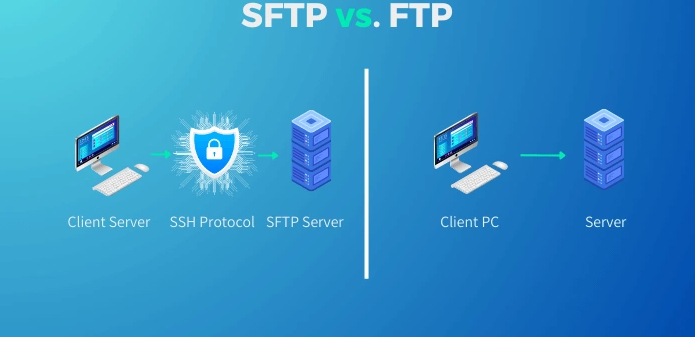
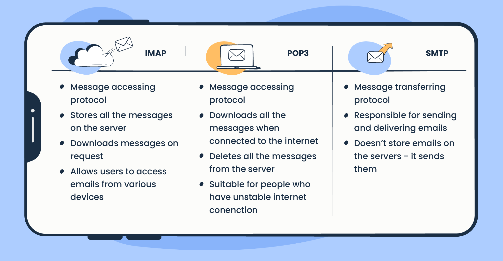

# Lecture 01 — The Web and Client–Server Communication

> **Core idea:** A browser requests resources through web protocols; servers process those requests and return responses the browser can render.

## Learning goals
- Explain how the Web differs from the Internet and identify the main roles in a web request.
- Distinguish client-side work from server-side work.
- Choose a suitable HTTP method and interpret common response status codes.
## Introduction To The Web
### Introduction
The **World Wide Web (Web)** is a collection of linked documents and resources accessed over the **Internet**. A web browser such as Chrome, Firefox, Safari, or Edge requests these resources and presents them as pages and applications.

Tim Berners-Lee proposed the Web at CERN in 1989 to help researchers share information. Key milestones:
- **1991**: The first website (info.cern.ch) went live, explaining the World Wide Web project.
- **1993**: CERN made the Web technology open and free for everyone, leading to rapid growth.
- **1990s**: The first web browsers (like Mosaic and later Netscape) made the Web user-friendly.
- **Late 1990s - Early 2000s**: The Dot-com boom saw the rise of major websites like Google (1998), Amazon, and eBay.
- **2000s–present**: Web applications became increasingly interactive and social. “Web 3.0” and “Web3” describe different, sometimes contested ideas; they are not a single settled next stage of the Web.
### Web Protocols
Network protocols define how devices address one another and exchange data. Different protocols handle different layers and purposes; a protocol does not automatically make communication secure.
#### Internet Protocol (IP)
An **IP address** identifies a network interface so packets can be routed to it. Addresses can be shared, reassigned, or hidden behind network translation, so an IP is not a permanent personal identifier. The two main versions are IPv4 and IPv6.

- **IPv4** uses 32-bit addresses such as `192.168.1.1`, allowing about 4.3 billion unique values. Address sharing and private ranges help extend its use, but the public address space is limited.

- **IPv6** uses 128-bit addresses such as `2001:db8:85a3::8a2e:370:7334`, providing about 3.4 × 10³⁸ possible addresses.
#### HTTP/HTTPS Protocol
**HTTP** defines how clients and servers exchange requests and responses. **HTTPS** is HTTP carried over TLS, which encrypts the connection and helps authenticate the server. HTTP commonly uses port 80; HTTPS commonly uses port 443. The browser’s connection indicator reports transport security, not whether a site itself is trustworthy.

  

#### FTP/SFTP Protocol
**FTP** transfers files between a client and server. Traditional FTP commonly uses port 21 and does not encrypt credentials or file contents. **SFTP** is a separate file-transfer protocol that runs over SSH, commonly on port 22, and encrypts the connection. Choose an encrypted transfer method when credentials or files must be protected.
  

#### SCP Protocol
**SCP** copies files between systems over SSH, protecting credentials and file contents in transit. It is commonly used from the command line for direct transfers between a local machine and a remote host. SFTP is often more convenient when browsing or managing remote files; use the tool supported by the environment and its security policy.
#### Real-Time Communication Protocol
For real-time web features, **WebSocket** and **WebRTC** address different communication needs.
**WebSocket** maintains a persistent, full-duplex connection between a client and server. It fits:
- Continuous chat applications
- Live notifications and updates
- Real-time collaborative tools
- Instant data synchronization   

After an HTTP-based handshake, either side can send messages without opening a new request for each update. Browser code can create a connection with `new WebSocket(url)`; `ws:` and `wss:` commonly use ports 80 and 443.
**WebRTC** (Web Real-Time Communication) supports low-latency peer connections, especially for audio, video, and data channels. It fits:
- Video conferencing applications
- Voice-over-IP services
- Direct file sharing between browsers
- Low-latency screen sharing  

WebRTC handles much of the connection negotiation and network traversal, but applications still need a **signaling channel** to exchange setup information. That channel may use WebSocket. Media or data can flow directly between peers when the network allows it, or through a relay.

#### Email Communication Protocols (SMTP, IMAP, POP3)
Email uses different protocols for sending and retrieving messages:
**SMTP** (Simple Mail Transfer Protocol) sends outgoing mail, including:
- Composing and sending new messages
- Forwarding emails to other servers
- Handling outgoing mail between mail servers  
    Mail servers commonly use port 25 to transfer mail between servers; clients commonly submit mail on port 587 with transport security.

**IMAP** (Internet Message Access Protocol) keeps mail on the server and synchronizes folders and message state across clients. It fits:
- Synchronized access across multiple devices
- Server-side folder organization
- Selective message downloading
- Online email management  
    IMAP commonly uses port 143, or port 993 for implicit TLS.

**POP3** (Post Office Protocol version 3) retrieves messages, often for local storage. It fits:
- Downloading emails to a single device
- Local storage of messages
- Offline access to mail  
    POP3 commonly uses port 110, or port 995 for implicit TLS. Whether retrieved messages remain on the server depends on client settings.

#### Domain Name System (DNS)
The **Domain Name System (DNS)** maps domain names, such as `example.com`, to records that clients use to find services, often including IP addresses. DNS is a distributed naming system rather than a single protocol; DNS queries can use different transport methods. Without DNS, users would need another way to locate hosts, such as entering IP addresses directly.
### Web Servers
“Web server” can mean the software that accepts HTTP requests, the machine running it, or both. A server may return stored files, generate a response with application code, or combine the two. When a user opens a URL, the browser resolves the host, connects to the service, sends an HTTP request, and receives a response. It then interprets the returned HTML, CSS, JavaScript, and media to render the page; a page may require additional requests for these resources.

### Web Browsers:
**Web browsers** request web resources and interpret them for users. Their main roles include:
1. **Retrieval**: Fetch resources from servers.
2. **Rendering**: Interpret HTML structure, CSS presentation, and JavaScript behavior to display pages and applications.
3. **Navigation**: Common tools include:
    - Tabbed browsing for multitasking
    - Bookmarks for saving favorite sites
    - History tracking for revisiting pages
    - Download management for saving files
4. **Content support**: Browsers can display:
    - Text documents and articles
    - Images, videos, and multimedia
    - Interactive web applications
    - PDFs and other document formats  

Popular browsers include Chrome, Firefox, Safari, and Edge. They also provide security features such as site isolation, phishing protection, and automatic updates; exact features vary by browser.
### Search Engine
**Search engines** help users find pages across the Web. A typical search pipeline has four stages:
1. **Crawling** – Automated bots (called "spiders") explore the web, discovering and indexing pages.
2. **Indexing** – They organize and store this data in massive databases for quick retrieval.
3. **Ranking** – When we search, complex algorithms analyze factors like relevance, quality, and popularity to rank results.
4. **Serving results** – Rank and present links, media, or direct answers for a query.

## Client-Side vs Server-Side
### Client-Side
**Client-side** work runs in the user’s browser. It covers the interface, page rendering, and interactions. **Front-end development** commonly uses:
#### HTML (HyperText Markup Language)
HTML defines page structure and meaning with elements such as headings, paragraphs, images, and buttons.
#### CSS (Cascading Style Sheets)
CSS controls presentation: layout, color, typography, and responsive behavior.
#### JavaScript
JavaScript adds logic and interaction, such as form feedback, animation, and content updates. It can update a page without a full reload, but the application may still need server requests for data.
### Server-Side
**Server-side** work runs on servers. It commonly handles application rules, authentication, data access, and response generation. **Back-end development** involves:
#### Server (Hardware/Software)
Servers provide the infrastructure and software that receive requests and run applications. Web server software includes Apache and Nginx; application servers may run alongside them.
#### Backend Programming Languages
Languages and runtimes such as Python, PHP, Java, and Node.js execute server-side logic, process data, and generate responses.
#### Databases
Databases such as MySQL, PostgreSQL, and MongoDB store and retrieve application data. Relational and document databases differ in data models and query patterns; security depends on configuration and application design.
#### APIs (Application Programming Interfaces)
APIs define how software components exchange data. A service may expose HTTP endpoints using conventions such as REST or a query language such as GraphQL; JSON is a common data format.

## Requests and Responses
### Introduction
HTTP communication follows a request–response model: a client sends a method, target, headers, and sometimes a body; the server returns a status code, headers, and sometimes a body. The method expresses the operation the client intends to perform.
### Type of Requests
#### GET Request
A **GET** request retrieves a representation of a resource. Browsers use it to fetch pages, images, and API data. GET is defined as safe and idempotent; it should not request a state-changing action.
#### POST Request
A **POST** request submits data for processing, often to create a resource or trigger an operation. Data is commonly sent in the request body, but a body is not encrypted unless the connection uses HTTPS. POST is not guaranteed to be idempotent.
#### PUT Request
A **PUT** request creates or replaces the target resource with the supplied representation, depending on the server’s API. It is idempotent: repeating the same request should have the same intended effect.
#### DELETE Request
A **DELETE** request asks the server to remove the target resource. It is idempotent by definition, though repeated responses may differ (for example, the first may succeed and the next may report that the resource is already gone).
### Types of Responses
#### 200 OK (Success Response)
A **200 OK** response indicates success and commonly includes a response body, such as the requested representation.
#### 201 Created (Resource Successfully Added)
A **201 Created** confirms that the request created a resource. A `Location` header may identify the new resource.
#### 204 No Content (Successful but Empty Response)
A **204 No Content** indicates success with no response body. It is common after a deletion or an update that needs no returned representation.
#### 400 Bad Request (Client-Side Error)
A **400 Bad Request** means the server cannot or will not process the request because it considers the request invalid, for example because of malformed syntax or invalid input.
#### 401 Unauthorized (Authentication Required)
A **401 Unauthorized** means valid authentication credentials are missing or not accepted. The name is historical; it concerns authentication.
#### 403 Forbidden (Access Denied)

A **403 Forbidden** means the server understood the request but refuses access. The client may be authenticated but lack permission; authentication is not always the reason.
#### 404 Not Found (Resource Missing)
A **404 Not Found** means the server did not find a current representation for the target, often because the URL is wrong or the resource was removed.
#### 500 Internal Server Error (Server Failure)
A **500 Internal Server Error** is a generic server-side failure. Check server logs and application behavior to diagnose it.
