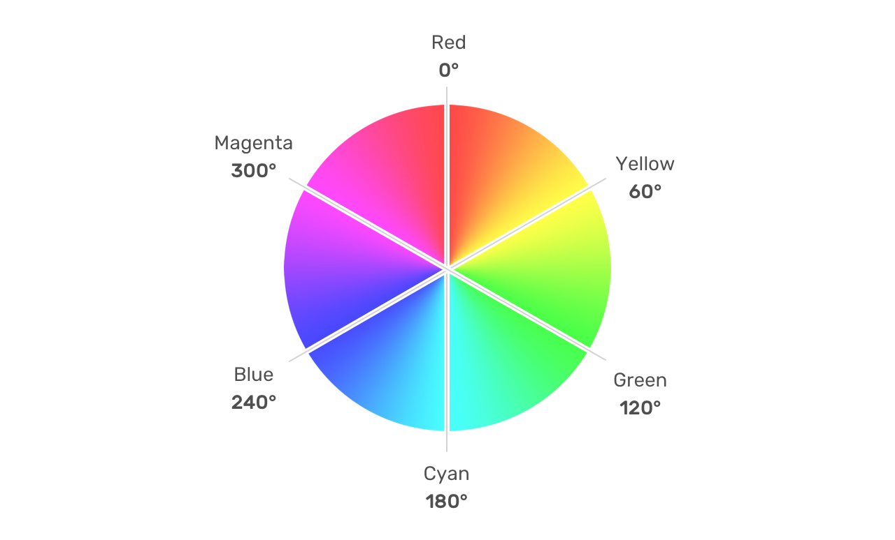
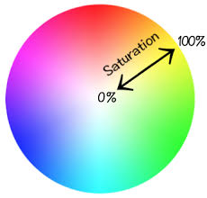
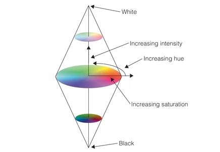

# Lecture 04 — CSS Foundations and the Box Model

> **Core idea:** CSS rules match HTML elements and assign visual values; the cascade chooses which rules win, while the box model explains an element’s size and spacing.

## Learning goals
- Add CSS with inline, internal, or external rules and explain their trade-offs.
- Select elements and reason about specificity and source order.
- Choose color and size units, style text, and calculate element dimensions with the box model.
## CSS
**CSS** (Cascading Style Sheets) controls how HTML content is presented: layout, color, typography, spacing, and visual effects. HTML describes structure and meaning; CSS describes appearance.
### Adding CSS to an HTML Page
CSS can be added inline, inside a `<style>` element, or in an external stylesheet:
#### Inline CSS
An inline `style` attribute applies declarations to one element. Keep it for exceptional, element-specific cases; it is harder to reuse and maintain.
```
<p style="color: blue; font-size: 16px;">This is a styled paragraph.</p>
```
#### Internal CSS
An internal `<style>` element holds CSS for one document. It can be useful for a small standalone page.
```
<head>
    <style>
        p {
            color: blue;
            font-size: 16px;
        }
    </style>
</head>
```
#### External CSS
An external stylesheet keeps styles separate and reusable. Link it from the document’s `<head>`:
```
<head>
    <link rel="stylesheet" href="styles.css">
</head>
```
### Structure of CSS Code
Each CSS rule has a **selector** and a declaration block. A declaration pairs a property with a value and ends with a semicolon.
```
p {
    color: blue;
    font-size: 16px;
}
```

This rule sets the text color and font size on every `<p>` element matched by the selector.
### Basic selectors
#### Element Selector
An element selector matches every element with that tag name.
```
p {
    color: blue;
    font-size: 16px;
}
```
#### Class Selector:
Use a dot followed by the class name to match elements with that class. Classes can be reused across elements.
```
.black_text {
    color:black;
}
```
#### ID Selector:
Use `#` followed by an ID to match an element. IDs should be unique within the document; prefer classes for reusable styling.
```
#header {
    font-size: 24px;
    color: darkblue;
}
```
### CSS Specificity and the Cascade
When several declarations set the same property on an element, the CSS cascade decides which value applies. It considers origin, importance, cascade layers, specificity, and source order.
#### Specificity:
- ID selectors (`#id`) outweigh class selectors (`.class`), which outweigh type selectors (`p`, `div`).
- Inline styles normally outweigh author stylesheet selectors. `!important`, origins, and cascade layers affect the full ordering, so specificity is not the only cascade rule.
#### Cascade:
- If competing declarations have equal priority and specificity, the one later in source order wins.
### Comments
CSS comments are ignored by the browser and can explain a non-obvious choice. Write them between `/*` and `*/`.
```
/* This is a comment */
p {
    color: blue; /* Change the text color to blue */
    font-size: 16px; /* Set the font size to 16 pixels */
}
```
## Colors and Units
### Colors
CSS color properties accept named colors and color functions or notations such as RGB, hexadecimal, and HSL.
#### Color Names:
CSS includes named colors such as `white`, `black`, `red`, `blue`, and `green`.
```
p {
color:black;
}
```
#### RGB and RGBA
The `rgb()` function sets red, green, and blue channel values. In the traditional 0–255 form, `0` is none and `255` is full intensity for that channel.
```
p {
color:rgb(255,0,0); /* pure red*/
}
```
The `rgba()` form adds an alpha channel from `0` (transparent) to `1` (opaque). Modern CSS also allows alpha in `rgb()`.
```
p {
    color: rgba(0, 0, 255, 0.3); /* Lightly transparent blue */
}
```
#### Hexadecimal Values
Hex colors combine channel values in one code: `#RRGGBB`. Each two-digit pair ranges from `00` (none) to `FF` (full intensity).
```
p {
color:#ff0000; /* pure red*/
}

```
#### HSL/HSLA Values
The `hsl()` function uses **Hue, Saturation, and Lightness**:
- **Hue**: Represents the color itself, specified as an angle between `0` and `360` on the color wheel.
    - `0` or `360` is red.
    - `120` is green.
    - `240` is blue.


  


- **Saturation**: Represents the intensity of the color, specified as a percentage.
    - `0%` is grayscale.
    - `100%` is fully saturated (vivid color).  
    
    

- **Lightness**: Represents the brightness of the color, specified as a percentage.
    - `0%` is black.
    - `50%` is the normal color.
    - `100%` is white.

  
```
h1 {
    color: hsl(0, 100%, 50%); /* Pure red */
}
```

The `hsla()` form adds alpha from `0` (transparent) to `1` (opaque). Modern CSS also allows alpha in `hsl()`.
```
p {
    color: hsla(240, 100%, 50%, 0.3); /* Lightly transparent blue */
}
```
#### Tools to set Colors:
There are many online tools that can help us when setting colors for our projects. These tools make it easy to select, customize, and convert colors into different formats like HEX, RGB, or HSL. Here are some popular ones you can use: 

1. **Adobe Color:** [color.adobe.com](https://color.adobe.com/)
	Adobe Color is a powerful tool that allows us to create beautiful color palettes, explore current color trends, and even test color accessibility.
2. **Coolors:** [coolors.co](https://coolors.co/)
	Coolors is a fast and easy-to-use tool for generating color palettes. With just a press of the spacebar, we can create new color combinations and lock the colors we like.
3. **HTML Color Codes:** [htmlcolorcodes.com](https://htmlcolorcodes.com/)
	HTML Color Codes is a beginner-friendly tool that offers a color picker, tutorials, and pre-made color palettes. It’s a great resource for learning about colors and how to use them effectively in our projects.
4. **Color Hunt:** [colorhunt.co](https://colorhunt.co/)
	Color Hunt is a fantastic tool for discovering modern and stylish color combinations. We can browse trending color palettes, save our favorites, and even submit our own creations.
5. **ColorZilla:** [colorzilla.com](https://www.colorzilla.com/)
	ColorZilla is a browser extension that allows us to pick colors directly from any webpage. It’s incredibly convenient for extracting colors from existing designs or websites.
6. **Paletton:** [paletton.com](https://paletton.com/)
	Paletton is a tool that helps us create color schemes based on color theory principles. It’s excellent for designing balanced and professional color palettes.
### Units
CSS units express lengths and other numeric values. Some are absolute; others are relative to a font, containing block, or viewport.
#### Absolute units
Absolute units have defined conversion relationships. On screens, a CSS pixel is a reference unit and does not always equal one physical display pixel; print units such as inches are more useful for physical sizing.

1. **Pixels (`px`)**: A common reference unit for screen layout.
```
div {
    width: 300px; /* Fixed width of 300 pixels */
}
```
2. **Points (`pt`):** Points are traditionally used in print media and are less common in web design. One point is equal to 1/72 of an inch.
```
h1 {
    font-size: 24pt;
}
```
3. **Inches (`in`), Centimeters (`cm`), and Millimeters (`mm`)**: These units are based on physical measurements and are typically used for print styles or specific design requirements.
```
.print-page {
    width: 8.5in;
    height: 11in; 
}
```
#### Relative Units
Relative units scale with a font size, containing block, or viewport. They help layouts adapt to context.

1. **Percentages (`%`)**: The reference depends on the property. For `width`, it is generally the containing block’s width.
```
div {
    width: 50%; 
}
```
2. **Ems (`em`)**: Relative to the element’s font size for many properties; for `font-size`, relative to the parent’s font size.
```
p {
    font-size: 1.5em; 
}
```
3. **Rems (`rem`)**: Relative to the root element’s font size, usually `<html>`.
```
h1 {
    font-size: 2rem; 
}
```
4. **Viewport units (`vw`, `vh`, `vmin`, `vmax`)**: Relative to viewport dimensions:
	- `1vw` = 1% of the viewport width.
	- `1vh` = 1% of the viewport height.
	- `vmin` and `vmax` are based on the smaller or larger dimension of the viewport, respectively.
```
section {
    width: 100vw; /* 100% of the viewport width */
    height: 50vh; /* 50% of the viewport height */
}
```
## Styling text
CSS typography and text properties affect readability, hierarchy, and emphasis.
### Text styling
#### Text Color:
Use `color` to set text color with a named color, hex value, or color function.
```
p {
    color: #0000ff;
}
```
#### Text Alignment
`text-align` aligns inline content within a block: `left`, `right`, `center`, or `justify`.
```
h1 {
    text-align: center;
}
```
`vertical-align` aligns inline-level content or table-cell content. Common values include:

- **`baseline`**: Aligns the element with the baseline of the parent (default).
- **`top`**: Aligns the element to the top of the line.
- **`middle`**: Aligns the element to the middle of the line.
- **`bottom`**: Aligns the element to the bottom of the line.
- **`sub`**: Aligns the element as subscript.
- **`super`**: Aligns the element as superscript.
- **`text-top`**: Aligns the element to the top of the parent’s font.
- **`text-bottom`**: Aligns the element to the bottom of the parent’s font.
```
sup {
    vertical-align: super; 
}

sub {
    vertical-align: sub; 
}
```
#### Text Decoration
`text-decoration` adds or removes lines such as `underline`, `overline`, and `line-through`.
```
.strike {
    text-decoration: line-through;
}
```
Set the decoration’s color, style, and thickness with the related longhand properties or shorthand:
```
p {  
	text-decoration: underline red double 5px;
}
```
#### Text Transformation
`text-transform` changes text presentation to `uppercase`, `lowercase`, or `capitalize`. It does not change the underlying text value.
```
p{
text-transform: lowercase;
}
```
#### Text Spacing
Spacing properties adjust line, letter, word, and paragraph spacing. A unitless `line-height` (for example, `1.5`) scales with the element’s font size and is usually a flexible choice.
```
p {
    line-height: 1.6;
}
```
`letter-spacing` controls spacing between characters.
```
p {
    letter-spacing: 2px;
}
```
`word-spacing` controls spacing between words.
```
p {
    word-spacing: 4px;
}
```
`text-indent` indents the first formatted line of a block.
```
p {  
	text-indent: 50px;
}
```
#### Text Shadow
`text-shadow` accepts horizontal and vertical offsets, an optional blur radius, and a color:

1. **Horizontal offset**: Moves the shadow left (negative value) or right (positive value).
2. **Vertical offset**: Moves the shadow up (negative value) or down (positive value).
3. **Blur radius**: Controls the blurriness of the shadow (optional).
4. **Color**: Defines the color of the shadow (optional).
```
h1 {
  text-shadow: 2px 2px 4px rgba(0, 0, 0, 0.5); 
}
```
Separate shadow layers with commas.
```
h1 {
  text-shadow: 1px 1px 2px red, -1px -1px 2px blue;
}
```
### Font Styling
#### Font size:
Use `font-size` to set text size. Common choices include `rem` for root-relative sizing and `em` for local scaling.
```
p {
    font-size: 16px;
}
```
#### Font Weight
`font-weight` controls typographic weight. Common values are `normal` (400), `bold` (700), or a supported numeric weight from 1 to 1000.
```
h2 {
    font-weight: bold; 
}

strong {
    font-weight: 700;
}
```
#### Font Family:
`font-family` lists preferred fonts followed by fallbacks. End with a generic family such as `serif`, `sans-serif`, or `monospace`.
```
/* Uses Arial, falls back to Helvetica, then sans-serif */
body {
    font-family: "Arial", "Helvetica", sans-serif; 
}
```
#### Font Style
`font-style` selects normal, italic, or oblique text. Use it to match the design; HTML elements such as `<em>` should carry meaning independently of appearance.

1. **Normal** The `normal` value displays text in its default style (not italic or oblique)
```
p {
    font-style: normal; 
}
```
2. **Italic** The `italic` value displays text in an italic style, which is often a slanted version of the font.
```
em {
    font-style: italic;
}
```
3. **Oblique** The `oblique` value also slants the text, but it’s a simulated version of italic. If the font doesn’t have a true italic version, the browser will slant the text artificially.
```
blockquote {
    font-style: oblique; 
}
```
### Styling lists
`list-style-type` controls markers, while `list-style-image` can supply an image marker. Preserve a visible marker when it helps users understand that content is a list.
#### Styling Ordered Lists (`<ol>`)
We can change the numbering format using the `list-style-type` property. For example:
```
ol {
  list-style-type: upper-roman; /* Changes numbers to uppercase Roman numerals */
}
```
Other options include:

- `decimal` (default numbers)
- `lower-alpha` (lowercase letters)
- `upper-alpha` (uppercase letters)
- `lower-roman` (lowercase Roman numerals)

#### Styling Unordered Lists (`<ul>`)
We can customize bullet points or replace them with images:
```
ul {
  list-style-type: square; 
}
ul {
  list-style-type: none; /* Removes bullets */
}
ul {
  list-style-image: url('star.png'); /* Replaces bullets with an image */
}
```
## Containers and the box model
### Display behavior
The `display` property controls how an element participates in layout. Common values include `block`, `inline`, `inline-block`, `flex`, `grid`, and `none`.
```
span {
  display: block;
}
div {
  display: inline;
}
```
`inline-block` boxes flow next to one another like inline content but accept width, height, and box spacing like block boxes.

- **Inline behavior**: Elements sit next to each other horizontally, just like inline elements.
- **Block behavior**: You can define specific dimensions (width and height) and apply spacing (padding and margins).

`display: none` removes the element and its descendants from layout and the accessibility tree. Use other hiding methods when content should remain available to assistive technology.
### Width and Height:
`width` and `height` set an element’s size. Consider `min-width`, `max-width`, and intrinsic sizing for layouts that need to adapt.
```
div {
  width: 300px;
  height: 150px;
}
```
### Background:
#### Background Color
`background-color` sets a solid background on an element.
```
.element {
  background-color: #3498db; /* Applies a blue background color */
}
```
#### Background Image:
`background-image` loads an image for an element’s background. Use HTML `` when the image conveys content that needs alternative text.
```
body {
  background-image: url('images/background.jpg');
}
```
Use related background properties to control repetition, position, size, and scrolling behavior:

1. **`background-repeat`**: This property specifies how the background image should be repeated to match the size of the element. It accepts the following values:
	- **`repeat`**: The image repeats both horizontally and vertically (default behavior).    
	- **`no-repeat`**: The image is displayed only once without repeating.
	- **`repeat-x`**: The image repeats only horizontally.
	- **`repeat-y`**: The image repeats only vertically.
	- **`space`**: The image repeats as much as possible without clipping, and the extra space is evenly distributed around the images.
	- **`round`**: The image repeats and scales to fit the element without leaving gaps.  


2. `background-position`: This property  specifies the starting position of a background image within an element. It allows you to control where the image is placed. it accept the folowing values
	- **Keyword Values**: `top`, `bottom`, `left`, `right`, `center`:
		``background-position: center top;``
	- **Percentage Values**: Adjusts the position based on percentages of the element’s size:
        ``background-position: 50% 50%; ``
	- **Length Values**: Uses specific units like pixels (`px`), ems (`em`), etc.:
		``background-position: 20px 10px; /* Positions 20px from the left and 10px from the top */``
	- **Mixed Values**: Combines keywords, percentages, or lengths:
		``background-position: right 10% bottom 20px; /* Aligns to the right, 10% from the top, and 20px from the bottom */``  
3. `background-size` controls image size within the element:
	- **`auto`**: The image retains its original size
	- **`cover`**: Scales the image to cover the entire element while maintaining its aspect ratio. Some parts of the image may be cropped.
	- **`contain`**: Scales the image to fit entirely within the element while maintaining its aspect ratio. The entire image will be visible, but there may be empty space.
	- **Specific Dimensions**: We can specify exact dimensions using units like pixels (`px`), percentages (`%`), etc.
	- **Mixed Values**: We can combine values to set width and height independently  

4. **`background-attachment`** controls how the image moves while scrolling:
	- **`scroll`**: The background image scrolls along with the element
	- **`fixed`**: The background image stays fixed relative to the viewport, even when the page is scrolled.
	- **`local`**: The background image scrolls with the element’s content, but remains fixed within the element itself.

```
body {
  background-image: url('images/cat.jpg'); 
  background-repeat: no-repeat;
  background-position: center center;
  background-size: cover;
  background-attachment: fixed;
}
```
### Margin and Padding
#### Margin
`margin` adds space outside the border and separates a box from its neighbors.
```
div {
  margin: 20px; 
}
```
Set each side separately:
```
div {
  margin-top: 10px;
  margin-right: 15px;
  margin-bottom: 20px;
  margin-left: 25px;
}
```
Or use the four-value shorthand, ordered top, right, bottom, left:
```
div {
  margin: 10px 15px 20px 25px; /* top, right, bottom, left */
}
```
#### Padding:
`padding` adds space between the content and the border.
```
div {
  padding: 20px;
}
```
Set each side separately:
```
div {
  padding-top: 10px;
  padding-right: 15px;
  padding-bottom: 20px;
  padding-left: 25px;
}
```
The four-value shorthand also follows top, right, bottom, left order:
```
div {
  padding: 10px 15px 20px 25px;
}
```
### Borders
The `border` shorthand sets width, style, and color:
1. **Width**: The thickness of the border (e.g., `2px`).
2. **Style**: The style of the border (e.g., `solid`, `dashed`, `dotted`).
3. **Color**: The color of the border (e.g., `#000000` or `red`).
```
div {
  border: 2px solid #3498db;
}
```
Set sides individually with `border-top`, `border-right`, `border-bottom`, or `border-left`:
```
div {
  border-top: 3px dashed red;
  border-bottom: 1px solid black; 
}
```
`border-radius` rounds the corners:
```
div {
  border-radius: 10px; /* Rounds all corners by 10px */
}
```
Four values set the top-left, top-right, bottom-right, and bottom-left radii:
```
border-radius: top-left top-right bottom-right bottom-left;
```
Example
```
div {
  border-radius: 10px 20px 30px 40px; 
}
```
### Box Sizing:
`box-sizing` determines whether declared width and height include padding and border.
- **`content-box`** (default): Width and height apply to content; padding and border increase the rendered size.
```
div {
  box-sizing: content-box;
  width: 200px;
  padding: 20px;
  border: 5px solid black;
  /* Total width = 200px (content) + 40px (padding) + 10px (border) = 250px */
}
```
- **`border-box`**: Width and height include content, padding, and border, making declared dimensions easier to reason about.
```
div {
  box-sizing: border-box;
  width: 200px;
  padding: 20px;
  border: 5px solid black;
  /* Total width = 200px (includes padding and border) */
}
```
### Box Shadow
`box-shadow` adds one or more shadows. A shadow can specify inset, x/y offsets, blur, spread, and color:
```
box-shadow: [horizontal offset] [vertical offset] [blur radius] [spread radius] [color];
```
1. **Horizontal offset**: Moves the shadow to the left (negative value) or right (positive value).
2. **Vertical offset**: Moves the shadow upward (negative value) or downward (positive value).
3. **Blur radius**: Controls the blurriness of the shadow. A larger value creates a softer, more diffused shadow.
4. **Spread radius**: Expands (positive value) or shrinks (negative value) the size of the shadow.
5. **Color**: Defines the color of the shadow. You can use color names, hex codes, or `rgba()` for transparency.
```
div {
    box-shadow: inset 0 0 10px red;
}
```
Separate multiple shadows with commas.
```
div {
    box-shadow: 3px 3px 5px rgba(0, 0, 0, 0.3), -3px -3px 5px rgba(255, 255, 255, 0.3);
}
```
### Opacity
`opacity` accepts a value from `0` (transparent) to `1` (opaque). It affects the whole element, including its descendants:
- **0** means the element is completely transparent (invisible).
- **1** means the element is fully opaque (completely visible).
```
div {
    opacity: 0.5; /* The element is 50% visible */
}
```
### Styling Tables:
Apply borders to table cells and the table to create a grid:
```
table, th, td {
    border: 1px solid black;
   
}
```
Adjacent borders can appear doubled. Set `border-collapse: collapse` on the table to combine them:
```
table, th, td {
    border: 1px solid black;
}
table {
    border-collapse: collapse;
}
```
## Task:
### Task 1 :
**Create an HTML file with the following structure:**
- Add a main heading (`<h1>`).
- Write three paragraphs (`<p>`).
- Include a blockquote (`<blockquote>`).
- Add a section (`<section>`) containing a subheading (`<h2>`) and two paragraphs.

**Style the elements using an external CSS file:**
1. **Main Heading (`<h1>`):**
	- Center-align the text.
	- Apply a text shadow: `2px 2px 3px darkgray`.
	- Use a custom font family with fallbacks (e.g., `"Arial", sans-serif`).
	- Set the color using a hex value (e.g., `#333`).
2. **Paragraphs (`<p>`):**
	- **First paragraph:** Set text color to blue using `rgb(0, 0, 255)`.
	- **Second paragraph:** Set text color to `green`, underline it, and customize the underline color (e.g., `text-decoration: underline red`).
	- **Third paragraph:** Set text color using `hsl(270, 100%, 50%)`, line height to `1.6`, and letter spacing to `1px`.
3. **Blockquote (`<blockquote>`):**
	- Style text in italics (`font-style: italic`).
	- Add a `30px` text indent.
	- Set a left border: `3px solid gray`.
	- Apply `15px` padding.
	- Use a semi-transparent background (e.g., `background-color: rgba(0, 0, 0, 0.2)`).
4. **Section (`<section>`):**
	- Apply a background color (e.g., `#f5f5f5`).
	- **Subheading (`<h2>`):** Convert text to uppercase (`text-transform: uppercase`).
	- **Last paragraph:** Indent the first line by `20px` (`text-indent: 20px`).
#### Solution:
You can find our solution here: https://alitigui.github.io/Front_end_solutions/Lecture4/solution1/index.html
### Task 2
**Create an HTML file with the following elements:**
- A header div
- Three card divs inside a container div
- A footer div  

**Style the elements using an external CSS file:**
1. **The header**:
    - Display as block
    - Height of 15vh
    - Width of 100%
    - A background color of your choice
    - Centered text
    - Padding of 20px
2. **The container**:
    - Display as block
    - Width of 90%
    - Margin: 0 auto (to center it)
    - Contains three cards displayed as inline-block
3. **Cards**:
    - Display as inline-block
    - Width of 300px
    - Height of auto
    - Margin of 1em
    - Padding of 20px
    - Border: 2px solid with a color of your choice
    - Border-radius of 10px
    - Box-shadow with your preferred values
    - Set `box-sizing` to `border-box`
    - Add some text content inside each card
    - Vertical-align: top (to align cards properly)
4. **The footer**:
    - Display as block
    - Height of 10vh
    - Width of 100%
    - Background color different from the header
    - Text centered both horizontally and vertically
	- Keep the footer in normal flow so it does not cover content. Use a fixed footer only when the design requires it and reserve space for the covered area.
#### Solution:
You can find our solution here: https://alitigui.github.io/Front_end_solutions/Lecture4/solution2/index.html
