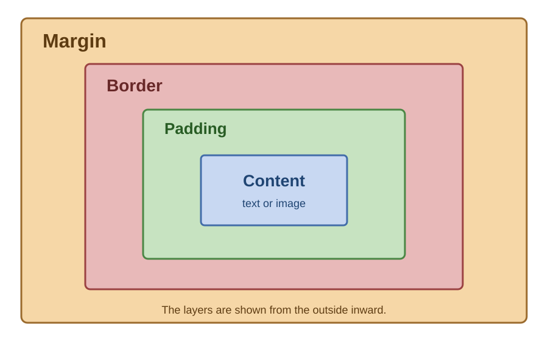

## Learning Objectives

By the end of this lecture, students should be able to:

- Explain how CSS controls the presentation of HTML.
- Connect an external stylesheet to an HTML document.
- Write basic CSS rules and select elements using element, class, and ID selectors.
- Explain the cascade, inheritance, and specificity at an introductory level.
- Set colors and dimensions using common CSS values and units.
- Style text, backgrounds, borders, spacing, and tables.
- Use the CSS box model to understand element dimensions.

## Introduction to CSS

**CSS (Cascading Style Sheets)** controls how HTML content is presented. HTML provides the structure and meaning of a page, while CSS controls its visual appearance. With CSS, a developer can choose colors and fonts, create spacing, arrange elements, add borders and shadows, and adapt a layout to different screen sizes.

The separation between HTML and CSS is important. It allows the content to remain meaningful even when the visual design changes. It also makes it possible to reuse one stylesheet across several pages, keeping the design consistent and easier to maintain.

## Adding CSS to an HTML Page

There are three common ways to apply CSS: inline styles, an internal stylesheet, and an external stylesheet.

### Inline CSS

Inline CSS is written directly in an element's `style` attribute:

```html
<p style="color: blue; font-size: 1rem;">This paragraph is blue.</p>
```

Inline CSS can be useful for a quick experiment, but it mixes content with presentation and is difficult to maintain when many elements need the same style. It should not be the normal approach for a larger project.

### Internal CSS

An internal stylesheet is written inside a `<style>` element, normally in the document's `<head>`:

```html
<head>
  <style>
    p {
      color: blue;
      font-size: 1rem;
    }
  </style>
</head>
```

This approach can be convenient for a short demonstration or a single-file example. However, if several pages share the same design, repeating the same CSS in each page creates unnecessary duplication.

### External CSS

For most projects, an external stylesheet is the recommended approach. CSS is stored in a separate `.css` file and connected to the HTML document through a `<link>` element:

```html
<head>
  <link rel="stylesheet" href="styles.css">
</head>
```

For example, `styles.css` might contain:

```css
body {
  font-family: Arial, sans-serif;
  color: #222;
  background-color: #f7f7f7;
}

h1 {
  color: #174a73;
}
```

When the stylesheet is linked correctly, the browser applies its rules to the matching elements. External CSS makes a project easier to organize, reuse, and update.

## The Structure of a CSS Rule

A CSS rule has a **selector** followed by a declaration block. Each declaration contains a property and a value:

```css
p {
  color: blue;
  font-size: 18px;
}
```

In this example, `p` is the selector. It targets paragraph elements. `color` and `font-size` are properties, while `blue` and `18px` are their values. Each declaration ends with a semicolon, and the declarations are placed inside curly braces.

A browser ignores CSS comments. Comments begin with `/*` and end with `*/`:

```css
/* Shared text styles */
p {
  line-height: 1.6;
}
```

## Basic CSS Selectors

A **selector** describes which HTML elements a rule should affect. Three selectors are especially important when starting CSS.

An **element selector** targets every element with a specified tag name:

```css
p {
  color: #333;
}
```

A **class selector** begins with a period (`.`) and targets elements that contain the specified class name. Classes can be reused on multiple elements:

```css
.notice {
  background-color: #fff3cd;
  padding: 1rem;
}
```

An **ID selector** begins with a hash (`#`) and targets the element with the matching ID. An ID should be unique within the document:

```css
#page-title {
  color: #174a73;
}
```

The corresponding HTML could be:

```html
<h1 id="page-title">Learning CSS</h1>
<p class="notice">Remember to save your work.</p>
<p class="notice">Practice each example in the browser.</p>
```

In everyday front-end development, classes are generally the most flexible choice for styling because they can be reused and combined. IDs are more often used for unique page targets or JavaScript hooks.

## The Cascade, Specificity, and Inheritance

The word **cascading** in CSS describes how the browser resolves situations where multiple rules apply to the same element. A property may be declared in several places, so the browser must determine which declaration wins.

The cascade considers several factors, including the origin and importance of a declaration, cascade layers, selector specificity, and source order. At an introductory level, students should remember these principles:

1. When declarations have comparable priority, a more specific selector generally wins.
2. An ID selector is more specific than a class selector, and a class selector is more specific than an element selector.
3. If competing declarations have the same specificity and priority, the later declaration in the relevant order generally wins.
4. Inline styles usually outrank normal stylesheet rules, but important declarations and the full cascade have additional rules.

For example:

```html
<p class="message" id="welcome">Welcome!</p>
```

```css
p {
  color: black;
}

.message {
  color: blue;
}

#welcome {
  color: darkgreen;
}
```

The text becomes dark green because the ID selector is more specific than the class and element selectors.

Some CSS properties are **inherited**. For example, `color` and `font-family` normally pass from a parent element to its descendants. Other properties, such as `margin`, `padding`, and `border`, do not normally inherit. Inheritance allows developers to set common text styles on a parent instead of repeating them on every child.

Avoid solving every styling conflict by adding `!important`. It can make the cascade harder to understand and maintain. Prefer clear class names and simple selector rules.

## Working with Colors

Color is one of the most visible parts of a design. CSS supports several ways to define a color, and all of them can be used in properties such as `color`, `background-color`, and `border-color`.

### Named Colors

CSS supports predefined color names such as `black`, `white`, `tomato`, `blue`, and `darkgreen`:

```css
p {
  color: darkgreen;
}
```

Named colors are easy to read, but a design system often needs more precise values.

### RGB and RGBA

RGB represents a color through its red, green, and blue components. In the traditional numeric form, each component ranges from `0` to `255`:

```css
h1 {
  color: rgb(255, 0, 0);
}
```

RGBA adds an alpha component to control transparency. The alpha value ranges from `0` (fully transparent) to `1` (fully opaque):

```css
.notice {
  background-color: rgba(0, 100, 200, 0.15);
}
```

### Hexadecimal Colors

Hexadecimal colors begin with `#` and usually contain six hexadecimal digits. The first pair represents red, the second pair green, and the third pair blue. Each pair ranges from `00` to `FF`:

```css
h1 {
  color: #ff0000; /* Red */
}
```

A three-digit shorthand is also available when each pair can be represented by a repeated digit, such as `#f00` for `#ff0000`.

### HSL and HSLA

HSL represents colors using **hue**, **saturation**, and **lightness**. Hue is an angle around a color wheel, saturation describes color intensity, and lightness describes how light or dark the color is.

- Hue is commonly represented from `0` to `360` degrees.
- Saturation ranges from `0%` (no color saturation) to `100%` (full saturation).
- Lightness ranges from `0%` (black) to `100%` (white), with `50%` representing the middle lightness.

```css
h1 {
  color: hsl(210, 80%, 35%);
}

.card {
  background-color: hsla(210, 80%, 35%, 0.1);
}
```

HSL can be convenient when creating a palette because a developer can adjust lightness while keeping the hue and saturation similar.


Color tools such as Adobe Color, Coolors, Color Hunt, and browser developer tools can help create palettes and inspect color values. When choosing colors, check text contrast so that content remains readable for people with different visual needs.

## CSS Units

CSS values often need units. The correct unit depends on what is being sized and whether the design should remain fixed or adapt to its context.

### Absolute Units

Absolute units represent fixed physical or CSS lengths. The most common unit in screen design is the **CSS pixel (`px`)**:

```css
.card {
  border-width: 1px;
}
```

Other units include `cm`, `mm`, `in`, `pt`, and `pc`, which are more commonly encountered in print-related CSS. A CSS pixel is not necessarily one physical screen pixel; browsers map CSS pixels to device pixels according to the display and zoom settings.

### Relative Units

Relative units depend on another value, such as the font size of an element, the root font size, or the viewport dimensions.

- `em` is relative to the element's font size for many properties. In `font-size`, it is relative to the inherited font size.
- `rem` is relative to the root element's font size.
- `%` is relative to a property-specific reference, often a containing element's size.
- `vw` and `vh` are relative to the viewport width and height.
- `vmin` and `vmax` are relative to the smaller or larger viewport dimension.

```css
.page {
  width: 90%;
  max-width: 70rem;
  margin-inline: auto;
}

h1 {
  font-size: 2rem;
}
```

Relative units are useful for flexible layouts. However, they should be selected with an understanding of their reference value; not every percentage or viewport unit is measured against the same thing.

## Styling Text

Typography strongly influences readability and the personality of a website. CSS provides properties for text alignment, decoration, transformation, spacing, and font selection.

### Text Properties

The `color` property controls text color. `text-align` controls the horizontal alignment of inline content inside a block. Common values are `left`, `right`, `center`, and `justify`.

```css
.page-title {
  color: #20364b;
  text-align: center;
}
```

The `text-decoration` property adds or removes lines such as underlines. The `text-decoration-color` and `text-decoration-style` properties can refine the result:

```css
a {
  text-decoration: underline;
  text-decoration-color: tomato;
}
```

The `text-transform` property changes the visual capitalization without changing the underlying text:

```css
.section-title {
  text-transform: uppercase;
}
```

Spacing can improve long passages. `line-height` controls the distance between lines, `letter-spacing` adjusts the space between characters, `word-spacing` adjusts the space between words, and `text-indent` indents the first line of a block.

```css
.article-text {
  line-height: 1.6;
  letter-spacing: 0.01em;
}

.article-text.first-paragraph {
  text-indent: 1.5em;
}
```

The `text-shadow` property creates a shadow behind text:

```css
h1 {
  text-shadow: 2px 2px 3px rgba(0, 0, 0, 0.25);
}
```

### Font Properties

The `font-size` property controls text size, while `font-weight` controls its thickness. `font-family` defines the preferred font and a list of fallback fonts. `font-style` is used for values such as `normal` and `italic`.

```css
body {
  font-family: Arial, Helvetica, sans-serif;
  font-size: 1rem;
}

h1 {
  font-size: 2.25rem;
  font-weight: 700;
}

blockquote {
  font-style: italic;
}
```

Always provide a generic fallback such as `sans-serif` or `serif`. This ensures the browser can choose an available font if the preferred typeface cannot be loaded.

## The CSS Box Model

Every element displayed by the browser can be understood as a rectangular box. The CSS box model describes the layers that determine its size and spacing:

1. **Content** — the text, image, or other content inside the element.
2. **Padding** — the space between the content and the border.
3. **Border** — the line surrounding the padding and content.
4. **Margin** — the space outside the border that separates the element from other boxes.



### Width, Height, and Display

The `width` and `height` properties set the size of the content box by default. The `max-width` and `min-width` properties are useful for setting boundaries. The `display` property determines how an element participates in layout, with common values including `block`, `inline`, `inline-block`, `none`, `flex`, and `grid`.

```css
.container {
  width: 90%;
  max-width: 72rem;
  margin-inline: auto;
}
```

A centered container with a maximum width is a common pattern: it uses available space on smaller screens but does not become excessively wide on a large display.

### Backgrounds

The `background-color` property sets a background color. The `background-image` property can display an image or gradient. When using background images, the following properties are especially useful:

- `background-repeat` controls whether the image repeats.
- `background-position` controls where the image is placed.
- `background-size` controls how it is scaled. `cover` fills the box and may crop the image; `contain` fits the full image and may leave empty space.
- `background-attachment` controls how the background behaves as the page scrolls.

```css
.hero {
  min-height: 24rem;
  background-image: url("images/hero.jpg");
  background-repeat: no-repeat;
  background-position: center;
  background-size: cover;
}
```

Use a text-readable overlay or a sufficiently strong background color when placing text on top of an image.

### Margin and Padding

Margin creates space outside an element's border. Padding creates space between the content and the border.

```css
.card {
  margin: 1rem;
  padding: 1.25rem;
}
```

The four sides can be set individually with `margin-top`, `margin-right`, `margin-bottom`, `margin-left`, and their padding equivalents. Shorthand syntax can set multiple sides in one declaration:

```css
.card {
  margin: 10px 15px 20px 25px; /* top, right, bottom, left */
  padding: 1rem 1.5rem;        /* top/bottom, left/right */
}
```

### Borders and Rounded Corners

A border has a width, style, and color. Common styles include `solid`, `dashed`, and `dotted`:

```css
.card {
  border: 2px solid #d7dce2;
  border-radius: 12px;
}
```

The `border-radius` property rounds the corners. Four values are interpreted in clockwise order beginning at the top-left corner.

### Box Sizing

With the default `box-sizing: content-box`, declared width and height describe only the content area. Padding and border are added outside those dimensions. With `box-sizing: border-box`, the declared width and height include the content, padding, and border.

```css
.card {
  box-sizing: border-box;
  width: 300px;
  padding: 20px;
  border: 5px solid #333;
}
```

With `border-box`, the card's outer width remains `300px`. This makes layout calculations easier. A common project-wide rule is:

```css
*,
*::before,
*::after {
  box-sizing: border-box;
}
```

### Shadows and Opacity

The `box-shadow` property adds a shadow around an element. Its values commonly describe horizontal offset, vertical offset, blur radius, spread radius, and color:

```css
.card {
  box-shadow: 0 4px 14px rgba(0, 0, 0, 0.12);
}
```

The `opacity` property controls the transparency of an entire element and its descendants. Its value ranges from `0` (fully transparent) to `1` (fully opaque):

```css
.disabled-preview {
  opacity: 0.5;
}
```

When only the background needs transparency, prefer a color with an alpha channel rather than reducing the opacity of the entire element. Otherwise, its text and child elements also become transparent.

## Basic Table Styling

CSS can make data tables easier to read. Apply borders to the table and its cells, and use `border-collapse: collapse` to remove the gaps between adjacent borders:

```css
table {
  width: 100%;
  border-collapse: collapse;
}

th,
td {
  border: 1px solid #cbd2d9;
  padding: 0.75rem;
  text-align: left;
}

th {
  background-color: #edf2f7;
}
```

## Key Takeaways

- CSS rules contain selectors and declarations.
- External stylesheets are generally the easiest to maintain.
- The cascade, specificity, and inheritance determine which styles apply.
- Colors can be written using names, RGB(A), hexadecimal, and HSL(A) values.
- Relative units help create flexible designs.
- Text styling should support readability and a clear hierarchy.
- Every element follows the box model: content, padding, border, and margin.
- `box-sizing: border-box` makes dimensions easier to reason about.

## Practical Exercises

### Task 1 Style a Simple Article

Create an HTML page containing a main heading, three paragraphs, a blockquote, and a section with a subheading and two paragraphs. Connect an external stylesheet.

Center the main heading, use a hexadecimal text color, and add a subtle text shadow. Give the paragraphs different color formats: RGB, a named color, and HSL. Adjust line height and letter spacing for readability. Style the blockquote with italic text, padding, a left border, and a lightly transparent background. Give the section a background color and make its subheading uppercase.

**Reference solution:** [Article styling example](https://alitigui.github.io/Front_end_solutions/Lecture4/solution1/index.html)

### Task 2 Build a Card Layout

Create a page with a header, a centered container holding three cards, and a footer. Give each card a fixed maximum width, padding, margin, border, rounded corners, and a subtle shadow. Use `box-sizing: border-box` so the cards' dimensions are predictable. Use `inline-block` for this exercise; in later lectures, you will learn more flexible layout systems.

The footer should remain at the bottom of the page content. Do not use `position: fixed` unless the design specifically requires the footer to remain visible while the page scrolls; a fixed footer can cover content on shorter screens.

**Reference solution:** [Card layout example](https://alitigui.github.io/Front_end_solutions/Lecture4/solution2/index.html)
