# Lecture 05 — CSS Selectors, Positioning, and Flexbox

> **Core idea:** Selectors choose which elements receive styles; positioning and Flexbox then control where those elements appear and how they share space.

## Learning goals
- Combine selectors and pseudo-classes to target elements precisely.
- Choose a positioning mode and understand its effect on normal document flow.
- Build one-dimensional layouts with Flexbox and its container and item properties.
## Advanced selectors
Selectors can match elements by type, class, attribute, relationship, state, or position.
### Grouping selectors
Separate selectors with commas to apply the same declarations to each match:
```
span, a{
	font-size:18px;
}
```
### Filter Elements by Class
Combine a type selector and class to match only paragraphs with the `intro` class:
```
p.intro {
    text-indent: 20px;
}
```
### Attribute Selectors
Attribute selectors match elements by an attribute or its value. This selects text inputs:
```
input[type="text"] {
    border: 1px solid #ccc;
}
```
### Universal selector
The universal selector (`*`) matches every element. Use it deliberately; broad rules can create unwanted inheritance or overrides.
```
* {
    color: red;
}
```
### Relative Selector
Combinators describe relationships between elements:
#### Child Selector (`>`)
The child combinator `>` matches direct children. Here it selects only the two paragraphs directly inside the `<div>`:
**Example :**  
HTML  
```
<div>
	<section>
		<p>paragraph1</p>
	</section>
	<p>paragraph2</p>
</div>
```
CSS
```
div > p {
  color: red;
}
```
Only **paragraph 2** matches; paragraph 1 is nested inside a `<section>`.
#### Descendant Selector (  )
The descendant combinator (a space) matches elements at any depth inside an ancestor:
**Example :**  
HTML  
```
<div>
	<section>
		<p>paragraph1</p>
	</section>
	<p>paragraph2</p>
</div>
```
CSS
```
div p {
  color: red;
}
```
Here, **both paragraphs** match because each is inside the `<div>`.
#### Adjacent Sibling Selector (`+`)
The adjacent sibling combinator `+` matches the first next sibling after the specified element:
```
h2 + p {
    margin-top: 0;
}
```
This removes the top margin from the first paragraph immediately after an `<h2>`.
#### General Sibling Selector (`~`)
The general sibling combinator `~` matches every later sibling of the same parent that fits the selector.
**Example :**  
HTML  
```
<div>
  <h2>Heading</h2>
  <p>Paragraph 1</p>
  <p>Paragraph 2</p>
  <p>Paragraph 3</p>
</div>
```
CSS
```
h2 ~ p {
  color: blue;
}
```
This styles all later `<p>` siblings of the `<h2>` in the same parent.
### Negation selector
`:not()` excludes elements that match the selector inside its parentheses:
**Example:**  
HTML:
```
<div>
  <p class="intro">Paragraph 1</p>
  <p>Paragraph 2</p>
  <p>Paragraph 3</p>
</div>
```
CSS:
```
p:not(.intro) {
  color: red;
}
```
This styles paragraphs that do not have the `intro` class.
### Pseudo-classes
Pseudo-classes match an element’s state or position without adding a class to the HTML. Examples include `:hover`, `:focus`, `:checked`, and `:nth-child()`.
#### States
Common state pseudo-classes include:
- **`:hover`**: Styles an element when the user hovers over it.
- **`:focus`**: Styles the element that currently receives keyboard input. Keep a visible focus indicator; `:focus-visible` can target cases where the browser determines it is useful.
- **`:checked`**: Styles a checkbox or radio button when it is checked by the user.
- **`:visited`**: Changes the style of a link that has been visited.
- **`:active`**: Styles an element while it is being clicked or activated.
- **`:default`**: Styles an element when it is in its default state (e.g., a default button in a form).
- **`:valid`**: Styles a form element when its input is valid.
- **`:invalid`**: Styles a form element when its input is invalid.
```
button:hover {
    background-color: yellow;
}
input:focus {
    border-color: blue;
}
a:visited {
        color: purple;
}

```
#### Positions
Structural pseudo-classes match children or siblings by position:
- **`:first-child`**: Selects the first child element within a parent.
- **`:last-child`**: Selects the last child element within a parent.
- **`:nth-child()`**: Matches by sibling position using a number, formula, `even`, or `odd`.
- **`:nth-last-child()`**: Uses the same matching rules but counts from the end.
- **`:first-of-type`:** Selects the first element of its type within a parent.
- **`:last-of-type`**: Selects the last element of its type within a parent.
- **`:nth-of-type()`** Selects elements of a specific type based on their position.
- **`:only-child`** : Selects an element if it is the only child of its parent.
- **`:only-of-type`**: Selects an element if it is the only one of its type within its parent.
- **`:empty`**: Matches an element with no child elements or text nodes.
```
li:first-child {
    font-weight: bold;
}

li:last-child {
    color: red;
}

li:nth-child(2) {
    background-color: yellow; 
}

li:nth-child(odd) {
    background-color: #f2f2f2; 
}

p:nth-of-type(3) {
    background-color: lightgray;
}
```
### Pseudo-Elements
Pseudo-elements style part of an element or create generated content:
- **`::first-letter`**: Styles the first letter of an element.
- **`::first-line`**: Styles the first line of an element.
- **`::before`** and **`::after`**: Create generated content before or after an element’s content. Use them for decoration, not essential information.
```
p::first-line {
        font-weight: bold;
}
p::before {
        content: "Note: ";
        font-weight: bold;
}
p::after {
        content: " (Read More)";
        color: blue;
}
```
### The :root Selector
`:root` matches the document root (usually `<html>`). It is a common place to define reusable custom properties:
#### Example
```
:root {
  --primary-color: #3498db; /* Define a variable */
  --secondary-color: #2ecc71;
}

h1 {
  color: var(--primary-color); /* Use the variable */
}

button {
  background-color: var(--secondary-color);
}
```
## Gradients
Gradients interpolate between color stops and can be used wherever CSS accepts an image, such as a background.
### Linear Gradient
A linear gradient blends color stops along a line. Set a direction and at least two colors:
```
background: linear-gradient(to right, red, yellow);
```
Use a keyword or angle for direction. In CSS, `0deg` points upward, `90deg` to the right, and `180deg` downward.
```
background: linear-gradient(to bottom, red, yellow);
background: linear-gradient(45deg, red, yellow);
```
Add as many color stops as the design needs; the browser interpolates between them.
**Example**:
```
div {
	width :200px;
	height:100px;
	background: linear-gradient(45deg, #ff00cc, #333399);
}

```
**Output:**   
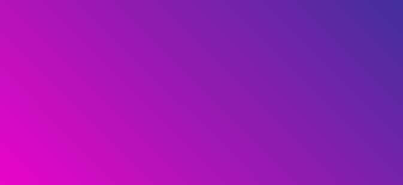    
```
div { 
width :400px; 
height:400px; 
background:linear-gradient(45deg, #ff9a9e, #fad0c4, #fbc2eb, #a6c1ee, #84fab0, #8fd3f4); 
}
```
**Output:**  
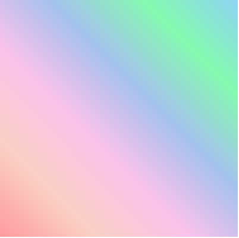  

### Radial Gradient
Radial gradients spread outward from a center. They can be circular or elliptical, with configurable size and position.
1. Shape:
	- `circle` Creates a gradient in the shape of a perfect circle.
	- `ellipse` Creates a gradient in the shape of an ellipse (oval). This is the **default shape** if no shape is specified.
2. Size:
	- **`closest-side`**: The gradient ends at the side closest to the center.
	- **`farthest-side`**: The gradient ends at the side farthest from the center.
	- **`closest-corner`**: The gradient ends at the corner closest to the center.
	- **`farthest-corner`**: The gradient ends at the corner farthest from the center (default).
3. Position:
		- Directional keywords position the center: **`top`**, **`bottom`**, **`left`**, **`right`**, **`center`**.
		- Percentages position the center relative to the element’s dimensions:
			- **`0% 0%`**: Top-left corner.
			- **`50% 50%`**: Center (default).
			- **`100% 100%`**: Bottom-right corner.
		- We can use absolute units like `px`, `em`, or `rem` to position the gradient's center
			- **`50px 100px`**: Positions the gradient 50px from the left and 100px from the top.

**Examples:**  
```
div { 
	width :400px; 
	height:400px; 
	background: radial-gradient(circle at bottom, #ff7e5f, #feb47b, #8fd3f4);
}
```
**Outputs:**  
  

```  
div { 
	width :400px; 
	height:400px; 
	background: radial-gradient(circle at 30% 30%, #ffffff, #cccccc, #666666, #333333);
}
```
**Outputs:**  
   

### Repeating gradients
Repeating gradients repeat color stops to create patterns such as stripes or concentric rings.
#### ``repeating-linear-gradient``: 
Repeats a linear gradient along a straight line.
```
div { 
	width :400px; 
	height:400px; 
	background: repeating-linear-gradient( 45deg, #333, #333 10px, #fff 10px, #fff 20px );
}
```
**Output:**  
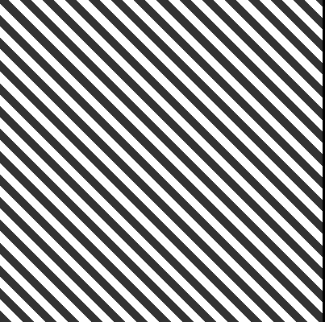  

**Explanation :**
The `45deg` gradient alternates dark and light bands. Hard color stops at `10px` and `20px` create sharp stripe edges; the pattern then repeats.
#### **``repeating-radial-gradient``**: 
Repeats a radial gradient outward from its center.
```
div { 
	width :400px; 
	height:400px; 
	background: repeating-radial-gradient( circle, black, black 1%, white 1%, white 2% );
}
```
**Output:**  
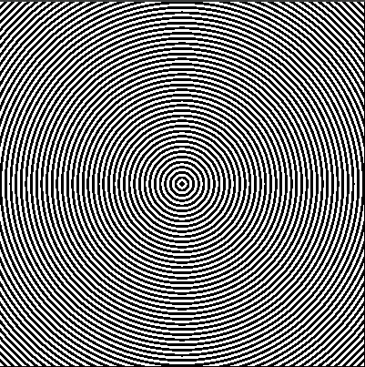  

**Explanation :**  
The circular gradient creates concentric rings. The hard stops at `1%` and `2%` alternate black and white bands; the gradient repeats between its final and initial stops.
## Positioning Elements
### Introduction
The `position` property controls how an element participates in normal flow. For positioned elements, `top`, `right`, `bottom`, and `left` set offsets from a containing block or viewport.
### `position` property
The `position` property accepts these common values:
#### **`static`**:
**`static`** is the default. The element remains in normal flow, and inset properties such as `top` and `left` do not move it.
#### **`relative`**
**`relative`** keeps the element’s original space in normal flow, then offsets its rendered position. For example, positive `top` moves it downward:
**Example:**  
**HTML**
```
<div class="container">
  <div class="box box1">Box 1</div>
  <div class="box box2">Box 2</div>
  <div class="box box3">Box 3</div>
</div>
```
**CSS**
```
.container {
  border: 2px solid black;
  padding: 20px;
}

.box {
  width: 100px;
  height: 100px;
  color: white;
  text-align: center;
  line-height: 100px;
}

.box1 {
  background-color: red;
}
.box2 {
  background-color: green;
  position: relative; 
  top: 20px; /* Push 20px from the top */
  left: 30px; /* Push 30px from the left */
}

.box3 {
  background-color: blue;
}
```
**Output**  
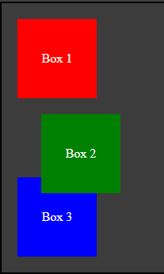  

#### **`absolute`**
**`absolute`** removes the element from normal flow and positions it against its containing block, commonly established by a positioned ancestor. If no ancestor establishes one, the initial containing block is used.
**Example:**  
**HTML**  
```
<div class="container">
  <div class="box box1">Box 1</div>
  <div class="box box2">Box 2</div>
  <div class="box box3">Box 3</div>
</div>
```
**CSS**  
```
.container {
  position: relative;
  border: 2px solid black;
  padding: 20px;
  height: 200px;
}

.box {
  width: 100px;
  height: 100px;
  color: white;
  text-align: center;
  line-height: 100px;
}

.box1 {
  background-color: red;
}

.box2 {
  background-color: green;
  position: absolute; /* Absolute positioning */
  top: 50px; /* 50px from the top of the container */
  left: 50px; /* 30px from the left of the container */
}

.box3 {
  background-color: blue;
}
```
**Ouput:**  
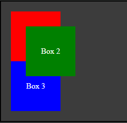  

**Explanation:**  
Box 2 is out of flow and positioned from `.container`, which establishes its containing block with `position: relative`. In this example the offsets are `50px` from the top and `50px` from the left. The other boxes keep their normal-flow positions.
#### `fixed`
**`fixed`** removes the element from normal flow and usually positions it relative to the viewport, so it stays in place while scrolling. A transformed ancestor can establish a different containing block.
### ``z-index``
`z-index` controls stacking within a stacking context. A larger value is painted above a smaller value in the same context; values in separate stacking contexts cannot always be compared directly.
#### Example:
**HTML**  
```
<div class="container">
  <div class="box box1">Box 1</div>
  <div class="box box2">Box 2</div>
  <div class="box box3">Box 3</div>
</div>
```
**CSS**  
```
.container {
  position: relative;
  border: 2px solid black;
  padding: 20px;
  height: 200px;
}

.box {
  width: 100px;
  height: 100px;
  color: white;
  text-align: center;
  line-height: 100px;
  position: absolute; 
}

.box1 {
  background-color: red;
  top: 20px;
  left: 20px;
  z-index: 1; 
}

.box2 {
  background-color: green;
  top: 50px;
  left: 50px;
  z-index: 2; 
}

.box3 {
  background-color: blue;
  top: 80px;
  left: 80px;
  z-index: 3; 
}
```
**Ouput:**  
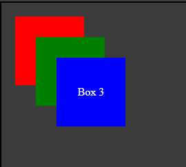  

#### Remark:
`z-index` applies to positioned elements and also to flex and grid items. Other properties can create stacking contexts.
## Flexbox

### Introduction
Flexbox lays out a container’s direct children along a main axis and aligns them on a cross axis. Set `display: flex` on the parent; its direct children become flex items.
### Container properties
#### `display`:
Create a flex container with `display: flex`:
```
.container{
	display:flex;
}
```
#### `flex-direction`
`flex-direction` sets the main axis. `row` follows the writing direction by default; `column` stacks items vertically. The `-reverse` values reverse visual order but not source order, so use them carefully for reading and keyboard navigation.
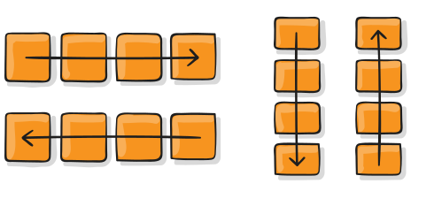  

#### ``flex-wrap``
`flex-wrap` controls whether items stay on one line or form additional flex lines:
- **`nowrap`**: All items are forced into a single line (default behavior).
- **`wrap`**: Items wrap to the next line if they exceed the container's width.
- **`wrap-reverse`**: Items wrap to the next line in reverse order.
#### ``flex-flow``
`flex-flow` is shorthand for `flex-direction` and `flex-wrap`.
```
.container { 
	flex-flow: column wrap; 
}
```
#### ``justify-content``
`justify-content` aligns or distributes items along the main axis:
- **`flex-start`**: Items are aligned at the start of the container (default).
- **`flex-end`**: Items are aligned at the end of the container.
- **`center`**: Items are centered within the container.
- **`space-between`**: Items are evenly distributed, with the first item at the start and the last item at the end.
- **`space-around`**: Items are evenly distributed with equal space around them.
- **`space-evenly`**: Items are evenly distributed with equal space between and around them.

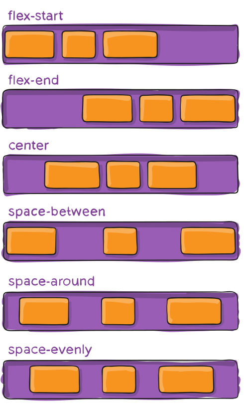  

#### ``align-items``
`align-items` aligns items along the cross axis (vertical in a row, horizontal in a column):
- **`stretch`**: Items stretch to fill the container (default).
- **`flex-start`**: Items are aligned at the start of the cross axis.
- **`flex-end`**: Items are aligned at the end of the cross axis.
- **`center`**: Items are centered along the cross axis.
- **`baseline`**: Items are aligned based on their text baselines.

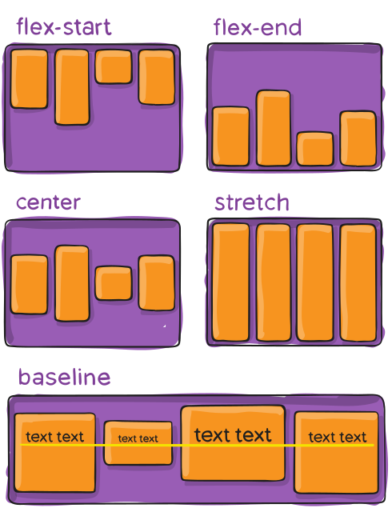  

#### ``align-content``
`align-content` distributes multiple flex lines along the cross axis when wrapping creates extra space. It has no visible effect when there is only one line or no extra space:
- **`stretch`**: Lines stretch to fill the remaining space (default).
- **`flex-start`**: Lines are packed at the start of the cross axis.
- **`flex-end`**: Lines are packed at the end of the cross axis.
- **`center`**: Lines are centered along the cross axis.
- **`space-between`**: Lines are evenly distributed, with the first line at the start and the last line at the end.
- **`space-around`**: Lines are evenly distributed with equal space around them.
- **`space-evenly`**: Lines are evenly distributed with equal space between and around them.

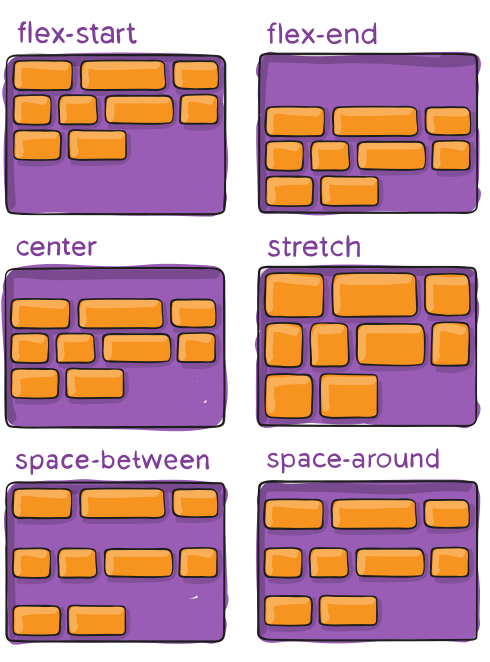  

#### `gap`,  `row-gap` and`column-gap`
Use `gap` to set spacing between flex items. `row-gap` and `column-gap` set the two directions separately; in the shorthand, one value sets both and two values set row then column gap.
### Items properties:
#### ``order``
`order` changes visual order without changing DOM or keyboard order. Items default to `0`; lower values appear first, and equal values keep source order. Prefer keeping source and visual order aligned.
- Items with a **lower `order` value** appear **first**.
- Items with a **higher `order` value** appear **later**.
- Items with the **same `order` value** appear in their **source order** (i.e., the order they appear in the HTML).
#### `flex-grow`
`flex-grow` assigns a share of positive free space to an item. The ratios apply to free space after the flex base sizes are considered, not necessarily the items’ final widths.
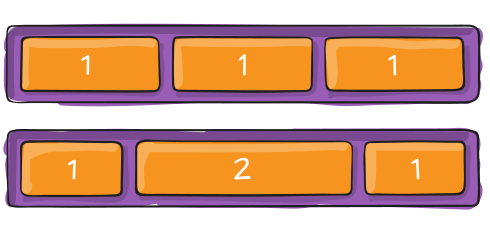  

#### `flex-shrink`
`flex-shrink` controls how items share negative free space when they do not fit. It defaults to `1`; set `0` to prevent an item from shrinking.
#### `flex-basis`
`flex-basis` sets an item’s initial size along the main axis before growing or shrinking.
#### `align-self`
`align-self` overrides the container’s `align-items` value for one item along the cross axis.
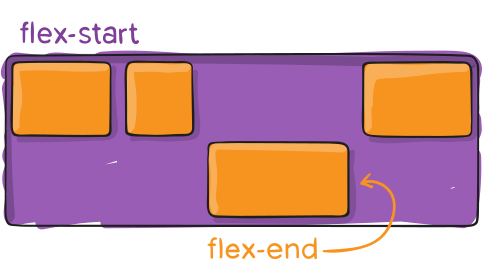  

## Task
Create a landing page for a fictional product using advanced CSS techniques.
#### Requirements:
1. **Advanced Selectors:**
    - Use pseudo-classes (`:hover`, `nth-child`) and pseudo-elements (`::before`, `::after`).
    - Style elements based on their state (e.g., hover effects, color changes on click).
2. **Gradient Colors:**
    - Apply **linear** or **radial gradients** to backgrounds (header, sections, footer).
3. **Positioning Elements:**
    - Use **absolute** or **relative positioning** for specific placement (images, text).
    - Experiment with **z-index** for layering elements (e.g., text over image).
4. **Working with Flexbox:**
    - Center content in the header and footer.
    - Use Flexbox to align items in the hero section and features section.
#### Design Elements:
1. **Header:**
    - Product name/logo left, navigation right, with a gradient background.
2. **Hero Section:**
    - Product image left, description right, styled with Flexbox and gradient text.
3. **Features Section:**
    - Display product features using icons/images and Flexbox.
4. **CTA Section:**
    - Include a prominent “Buy Now” button with hover effects, gradient background.
5. **Footer:**
    - Social media icons and navigation links, aligned with Flexbox.
#### Solution:
You can find our solution here: https://alitigui.github.io/Front_end_solutions/Lecture5/solution/index.html
