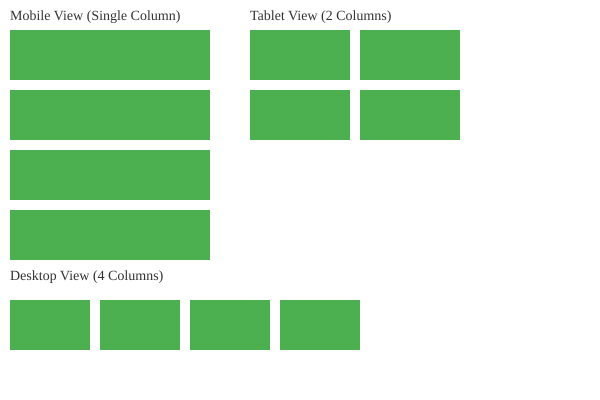

## Learning Objectives

By the end of this lecture, students should be able to:

- Explain when CSS Grid is a suitable layout tool.
- Define grid columns, rows, gaps, and named areas.
- Place and align individual grid items.
- Distinguish alignment of items within cells from alignment of the whole grid.
- Create responsive layouts using flexible tracks and media queries.
- Apply a mobile-first approach to page design.

## Introduction to CSS Grid

**CSS Grid Layout** is a two-dimensional layout system. It allows a developer to arrange elements in both rows and columns, making it especially useful for page-level structures and complex content layouts.

Flexbox is designed mainly for one-dimensional arrangements, such as a row of navigation links or a column of buttons. Grid is designed for two-dimensional arrangements, such as a dashboard with a header, sidebar, main content area, and footer. The two systems can be used together: Grid can create the overall page layout, while Flexbox aligns the contents of individual components.

To create a grid, apply `display: grid` to the parent element. Its direct children become grid items:

```css
.grid-container {
  display: grid;
}
```

## Defining Grid Columns and Rows

The `grid-template-columns` property defines the columns in the grid. The `grid-template-rows` property defines its rows.

### Fixed Track Sizes

We can create columns with fixed sizes:

```css
.container {
  display: grid;
  grid-template-columns: 120px 240px 180px;
}
```

This creates three columns with the specified widths. Fixed tracks are useful when a component has a known size, but a layout made entirely of fixed tracks may not adapt well to different screen sizes.

### Flexible Tracks with `fr`

The `fr` unit represents a fraction of the available space in the grid container after fixed sizes and gaps are accounted for:

```css
.container {
  display: grid;
  grid-template-columns: 1fr 2fr 1fr;
}
```

The middle track receives twice the share of the first and third tracks. The `fr` unit is useful for distributing available space without calculating exact pixel dimensions.

### Repeated and Mixed Tracks

The `repeat()` function avoids writing the same track definition multiple times:

```css
.container {
  display: grid;
  grid-template-columns: repeat(3, 1fr);
}
```

Tracks can also combine fixed and flexible sizes:

```css
.container {
  display: grid;
  grid-template-columns: 14rem 1fr;
}
```

Here, the first column has a fixed basis while the second takes the remaining available space.

### `minmax()`, `auto-fit`, and `auto-fill`

The `minmax()` function defines a minimum and maximum size for a track. It is useful when a column must not become too narrow but should be allowed to expand:

```css
.container {
  display: grid;
  grid-template-columns: repeat(3, minmax(12rem, 1fr));
}
```

For a card gallery, the combination of `repeat()`, `auto-fit`, and `minmax()` can create a responsive layout with fewer media queries:

```css
.card-grid {
  display: grid;
  grid-template-columns: repeat(auto-fit, minmax(15rem, 1fr));
  gap: 1.5rem;
}
```

The browser creates as many columns as can fit while respecting the minimum track size. `auto-fit` collapses empty repeated tracks so that remaining tracks can expand; `auto-fill` retains the track slots even when some are empty. For many card layouts, `auto-fit` is a practical starting point.

The `auto` keyword can size a track based on its content and available space. Use it when content should influence the track size, but be careful with long unbreakable content that can force a layout wider than expected.

### Defining Rows

Rows are defined in the same way as columns:

```css
.container {
  display: grid;
  grid-template-rows: auto 1fr auto;
  min-height: 100vh;
}
```

This pattern can describe a page with a content-sized header, a flexible main region, and a content-sized footer. Fractional row sizes depend on the grid container having an appropriate available height.

## Named Grid Areas

The `grid-template-areas` property allows us to describe a layout using names. Each quoted line represents a row, and each name identifies a named area. A period (`.`) represents an empty cell.

```html
<div class="page-layout">
  <header class="header">Header</header>
  <nav class="sidebar">Navigation</nav>
  <main class="main">Main content</main>
  <footer class="footer">Footer</footer>
</div>
```

```css
.page-layout {
  display: grid;
  grid-template-columns: 15rem 1fr;
  grid-template-rows: auto 1fr auto;
  grid-template-areas:
    "header header"
    "sidebar main"
    "footer footer";
  gap: 1rem;
}

.header  { grid-area: header; }
.sidebar { grid-area: sidebar; }
.main    { grid-area: main; }
.footer  { grid-area: footer; }
```

Named areas make the overall structure easier to read. The `grid-template` shorthand can combine row, column, and area definitions, but writing the longhand properties separately is often clearer while learning.

## Grid Gaps and Alignment

The `gap` property controls the space between rows and columns. `row-gap` and `column-gap` can be used separately:

```css
.grid {
  display: grid;
  row-gap: 1.5rem;
  column-gap: 1rem;
}
```

The following properties align **grid items inside their own grid areas**:

- `justify-items` aligns items along the inline axis.
- `align-items` aligns items along the block axis.
- `place-items` is a shorthand for `align-items` and `justify-items`.

Common values include `start`, `end`, `center`, and `stretch`:

```css
.grid {
  display: grid;
  place-items: center;
}
```

The following properties align or distribute **the grid tracks as a group inside the grid container**, when there is extra space:

- `justify-content` works along the inline axis.
- `align-content` works along the block axis.
- `place-content` combines the two.

These properties do not usually have a visible effect when the grid tracks already occupy all available space. They are different from `justify-items` and `align-items`, which align each item within its cell.

## Automatically Created Tracks

Sometimes grid items are placed outside the explicitly defined rows or columns. The browser creates additional **implicit tracks**. The `grid-auto-rows` and `grid-auto-columns` properties control their sizing:

```css
.grid {
  display: grid;
  grid-template-columns: repeat(3, 1fr);
  grid-auto-rows: minmax(10rem, auto);
}
```

The `grid-auto-flow` property controls the direction in which automatically placed items fill the grid. Common values are `row`, `column`, `row dense`, and `column dense`.

## Placing Individual Grid Items

Grid items can span or occupy particular tracks. Grid lines are numbered, starting at line `1` along each axis.

```css
.featured {
  grid-column-start: 1;
  grid-column-end: 3;
}
```

This makes the item span from column line 1 to column line 3, occupying two columns. The shorthand `grid-column` expresses the same placement more concisely:

```css
.featured {
  grid-column: 1 / 3;
}
```

The equivalent properties for rows are `grid-row-start`, `grid-row-end`, and the `grid-row` shorthand. An item can also span a number of tracks:

```css
.featured {
  grid-column: span 2;
}
```

The `grid-area` property can place an item into a named area or specify row and column lines. For example:

```css
.featured {
  grid-area: 1 / 1 / 3 / 3;
}
```

The `justify-self` and `align-self` properties align one item inside its grid area, overriding the defaults set by `justify-items` and `align-items`. `place-self` is their shorthand.

## Responsive Web Design

People use websites on phones, tablets, laptops, desktop monitors, and other devices. A layout that looks comfortable on a wide screen may be difficult to use on a narrow screen. **Responsive web design** is the practice of building interfaces that adapt to the available space while preserving content, usability, and accessibility.

Responsive design is not simply about making everything smaller. It involves choosing layouts, sizes, and spacing that work well at different widths. A responsive page should avoid horizontal scrolling for ordinary content, preserve readable text, keep controls usable, and allow images and other media to fit their containers.

### The Viewport Meta Tag

Include the viewport metadata in the document's head:

```html
<meta name="viewport" content="width=device-width, initial-scale=1.0">
```

This tells mobile browsers to use the device's CSS viewport width rather than a wide virtual layout viewport.

### Media Queries

A **media query** applies CSS only when a condition is true. It is commonly used to adjust a layout at a chosen viewport width:

```css
.card-grid {
  display: grid;
  grid-template-columns: 1fr;
  gap: 1rem;
}

@media (min-width: 600px) {
  .card-grid {
    grid-template-columns: repeat(2, 1fr);
  }
}

@media (min-width: 900px) {
  .card-grid {
    grid-template-columns: repeat(3, 1fr);
  }
}
```

In this example, the base layout has one column. At wider viewport widths, it changes to two and then three columns. The breakpoints should be chosen based on where the content needs them, not only because a particular device is called a phone or tablet.



Media queries can also target other conditions. For example, print styles can hide navigation and other elements that are not useful on paper:

```css
@media print {
  nav,
  .no-print {
    display: none;
  }

  body {
    color: black;
    background: white;
  }
}
```

### Mobile-First Design

A **mobile-first** approach starts with a simple layout for narrow screens and adds enhancements as more space becomes available. This encourages developers to prioritize essential content and functionality before adding more complex arrangements.

```css
.layout {
  display: grid;
  grid-template-columns: 1fr;
  gap: 1rem;
}

@media (min-width: 800px) {
  .layout {
    grid-template-columns: 2fr 1fr;
  }
}
```

This approach is often easier to maintain than starting with a wide layout and trying to remove complexity for smaller screens.

### Flexible Sizes and Content Constraints

Use flexible units where appropriate. Percentages, `rem`, `em`, `fr`, and viewport units can help a layout adapt to its context. However, fixed sizes are not always wrong: a thin border or a small icon may need a pixel-based value. The goal is to choose a unit that fits the design requirement.

The `min-width`, `max-width`, `min-height`, and `max-height` properties define size boundaries. They help prevent elements from becoming too large or too small. For example:

```css
.article {
  width: 90%;
  max-width: 68rem;
  margin-inline: auto;
}

.hero {
  min-height: 60vh;
}

img {
  max-width: 100%;
  height: auto;
}
```

For responsive images, `max-width: 100%` prevents an image from overflowing its container, while `height: auto` preserves its aspect ratio.

## Choosing Between Flexbox and Grid

Both Flexbox and Grid are valuable tools, and many components can be built with either. A useful guideline is:

- Use **Flexbox** when content should flow along one main axis, such as a navigation bar, button group, or row of controls.
- Use **Grid** when the design needs to coordinate rows and columns, such as a page structure, dashboard, or card gallery.

Do not choose a layout system because it is newer or more powerful. Choose the one that makes the structure easiest to express and maintain.

## Key Takeaways

- Grid is a two-dimensional layout system that manages rows and columns.
- `fr`, `repeat()`, `minmax()`, `auto-fit`, and `auto-fill` support flexible track sizing.
- Named grid areas make page structures easier to describe.
- Item alignment and whole-grid alignment are controlled by different properties.
- Responsive design adapts content to available space, not merely to named devices.
- Media queries apply styles based on viewport or other conditions.
- A mobile-first layout starts with the essential narrow-screen experience and expands as space permits.

## Practical Project — Responsive Restaurant Website

Build a responsive restaurant website using Grid for the main page structure and Flexbox for the alignment of smaller components.

### Required Sections

1. **Header and navigation** — Show a restaurant name or logo and links to the main sections. The navigation should remain usable on narrow screens.
2. **Hero section** — Include a large image or background, a short introduction, and a call-to-action button.
3. **Featured dishes** — Display six dish cards. Use one column on narrow screens, two columns on medium screens, and three columns on wide screens.
4. **Menu section** — Display food items with an image, name, price, and action button.
5. **Contact section** — Include a contact form and an embedded map. Stack them on narrow screens and place them side by side when enough space is available.
6. **Footer** — Include opening hours, social links, and copyright information.

Use meaningful HTML, responsive images, Grid, Flexbox, and at least two media queries. Test your page at several viewport widths rather than checking only one desktop and one mobile size.

**Reference solution:** [Responsive restaurant website](https://alitigui.github.io/Front_end_solutions/Lecture6/solution/index.html)
