# Lecture 06 — CSS Grid and Responsive Layouts

> **Core idea:** Grid places content across rows and columns; responsive sizing lets the layout adapt to the available space.

## Learning goals
- Define grid tracks, gaps, and item placement with CSS Grid.
- Choose flexible track sizes and repeat patterns for common layouts.
- Adapt a layout to different viewport sizes without relying on fixed dimensions everywhere.
## CSS Grid
Set `display: grid` on a container to create a two-dimensional layout. Its direct children are grid items, which can be placed into rows, columns, or named areas.
### Container properties
#### `grid-template-columns`
`grid-template-columns` defines explicit column tracks. Common sizing patterns include:
1. **Fixed Column Sizes**:
    ```
    grid-template-columns: 100px 200px 175px;
    ```

    This creates three columns: the first column has a fixed width of 100px, the second has a width of 200px, and the third has a width of 175px.
2. **Flexible Column Sizes (using `fr`)**:
    ```
    grid-template-columns: 1fr 2fr 1fr;
    ```
    The tracks share available space in a `1:2:1` ratio after their minimum sizing constraints are considered.
3. **Mixed Sizes**:
	```
    grid-template-columns: 100px 1fr 2fr;
	```    
    The first track is 100px; the other two share the remaining space in a `1:2` ratio, subject to track sizing constraints.
4. **Repeating Columns**:
    ```
    grid-template-columns: repeat(3, 1fr);
    ```
    This creates three equal-width columns.
5. **Using `minmax(min, max)`**:
	 ```
    grid-template-columns: minmax(100px, 1fr) 2fr;
    ```
    The first track has a 100px minimum and may grow into available space. The second track receives a `2fr` share.
6. **Auto-Sized Columns**:
   ```
    grid-template-columns: auto 1fr auto;
    ```
    The outer tracks size from their content; the middle track receives the remaining flexible space.
#### `grid-template-rows`
`grid-template-rows` defines explicit row tracks. Fixed and flexible sizes work like column tracks; `fr` sizing is most useful when the grid container has a definite height.
1. **Fixed Row Sizes**:
	```
    grid-template-rows: 100px 200px 175px;
    ```
    This creates three rows: the first row has a fixed height of 100px, the second has a height of 200px, and the third has a height of 175px.
2. **Flexible Row Sizes (using `fr`)**:
    ```
    grid-template-rows: 1fr 2fr 1fr;
   ``` 
    This creates flexible-sized rows where the second row takes up twice the space of the first and third rows.
3. **Mixed Sizes**:
    ```
    grid-template-rows: 100px 1fr 2fr;
    ```
    This creates three rows: the first row has a fixed height of 100px, while the second and third rows share the remaining space. The third row takes up twice the space of the second row.
4. **Repeating Rows**:
    ```
    grid-template-rows: repeat(3, 1fr);
    ```
    This creates three equal-height rows.
5. **Using `minmax(min, max)`**:
    ```
    grid-template-rows: minmax(100px, 1fr) 2fr;
    ```
    The first track has a 100px minimum and can grow into available space; the second track receives a `2fr` share.
    
6. **Auto-Sized Rows**:
	```
    grid-template-rows: auto 1fr auto;
    ```
    The first and third rows will shrink or grow based on their content, while the second row takes up the remaining space.
#### `grid-template-areas`
`grid-template-areas` gives parts of the layout names, then places those names on a visual grid. Each quoted row must contain the same number of cells; use `.` for an empty cell.
**Example:**
```
.item-a { grid-area: header; }
.item-b { grid-area: main; }
.item-c { grid-area: sidebar; }
.item-d { grid-area: footer; }

.container {
  display: grid;
  grid-template-columns: repeat(4, 50px);
  grid-template-areas:
    "header header header header"
    "main main . sidebar"
    "footer footer footer footer";
}
```
**Output:**  
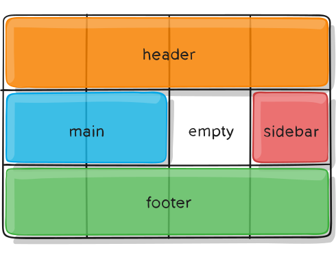  

Assign each item a name with `grid-area`; the container’s `grid-template-areas` places it.
#### `grid-template`

`grid-template` is shorthand for explicit rows, columns, and named areas.
```
.container {
  display: grid;
  grid-template: auto 1fr / 200px 1fr;
}

.page {
  display: grid;
  grid-template:
    "header header" auto
    "sidebar main" 1fr
    / 200px 1fr;
}
```

#### `row-gap`, `column-gap` and `gap`
`row-gap` and `column-gap` set spacing between grid tracks:
```
.container {
	column-gap: 15px;
	row-gap: 20px;
}
```
`gap` is shorthand: one value sets both directions; two values set row gap then column gap.
```
.container {
	gap: 20px 15px;
}

```
#### `justify-items`
`justify-items` sets the default inline-axis alignment of items in their cells:
- **`start`**: Aligns items to the left side of their grid cell.  
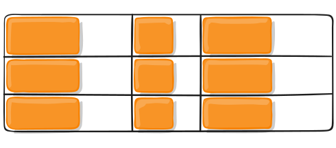

- **`end`**: Aligns items to the right side of their grid cell.  
- 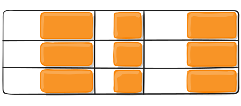  

- **`center`**: Centers items horizontally within their grid cell.  
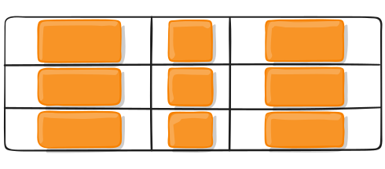

- **`stretch`**: (Default) Stretches items to fill the entire width of their grid cell.  
  


        
#### `align-items`
`align-items` sets the default block-axis alignment of items in their cells:
- **`start`**: Aligns items to the top of their grid cell.  
  

- **`end`**: Aligns items to the bottom of their grid cell.  
  

- **`center`**: Centers items vertically within their grid cell.  
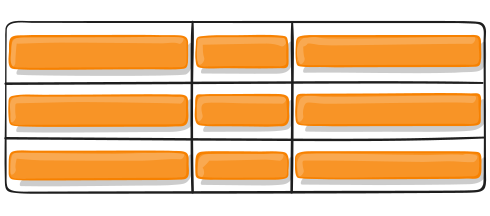  

- **`stretch`**: (Default) Stretches items to fill the entire height of their grid cell.    
  

#### `place-items`
`place-items` combines `align-items` and `justify-items`:
```
place-items: <align-items> <justify-items>;
```
If only one value is provided, it applies to both **`align-items`** and **`justify-items`**.
#### `justify-content`
`justify-content` positions or distributes the grid tracks along the inline axis when the grid is smaller than its container:
- **`start`**: Aligns the grid to the left side of the container (default).  
  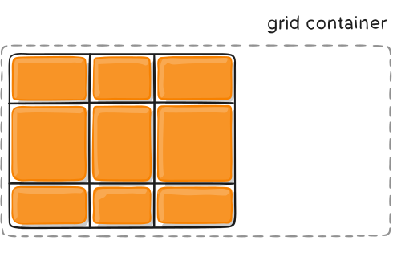
  
- **`end`**: Aligns the grid to the right side of the container.  
    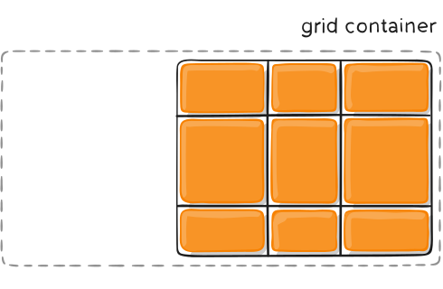
  
- **`center`**: Centers the grid horizontally within the container.  
    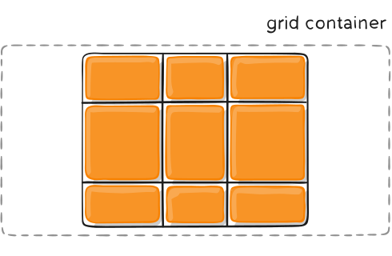
  
- **`stretch`**: Stretches the grid tracks to fill the container's width (if track sizes are not fixed).   
     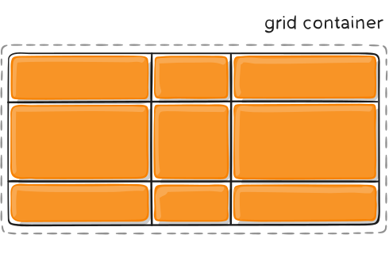
  
- **`space-around`**: Distributes equal space around each grid track, with half-sized spaces at the edges.   
     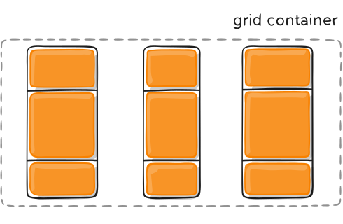
  
- **`space-between`**: Distributes equal space between grid tracks, with no space at the edges.  
     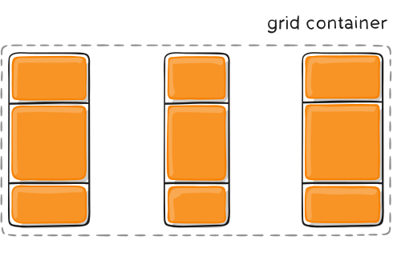
  
- **`space-evenly`**: Distributes equal space around and between grid tracks.  
 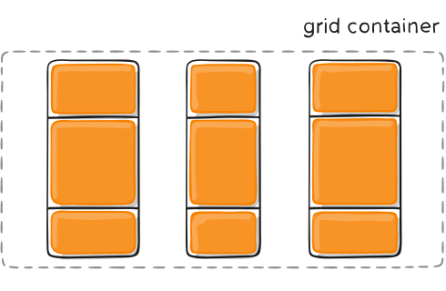


#### `align-content`
`align-content` positions or distributes grid tracks along the block axis when the grid is smaller than its container:
- **`start`**: Aligns the grid to the top of the container.  
      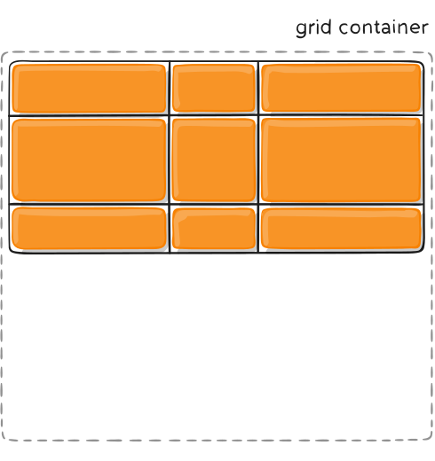
  
- **`end`**: Aligns the grid to the bottom of the container.  
    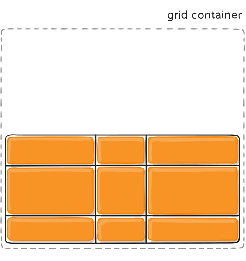
  
- **`center`**: Centers the grid vertically within the container.  
    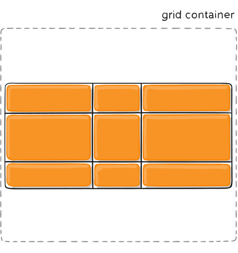
    
- **`stretch`**: Stretches the grid tracks to fill the container's height (if track sizes are not fixed).  
    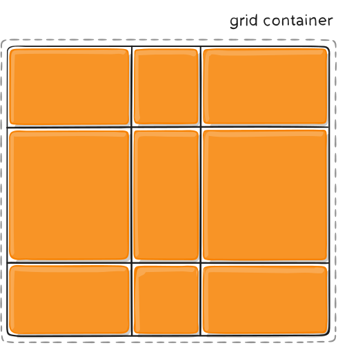
  
- **`space-around`**: Distributes equal space around each grid track, with half-sized spaces at the edges.  
    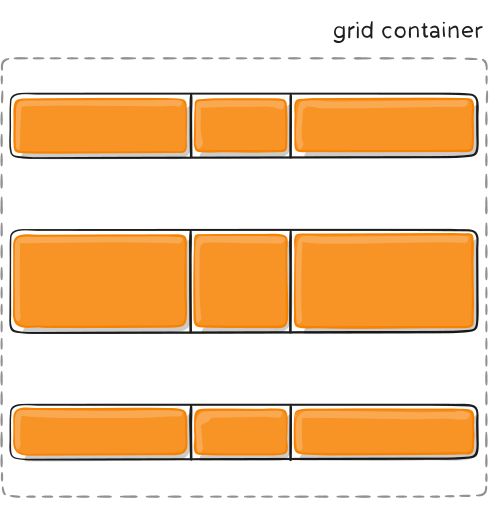
  
- **`space-between`**: Distributes equal space between grid tracks, with no space at the edges.  
     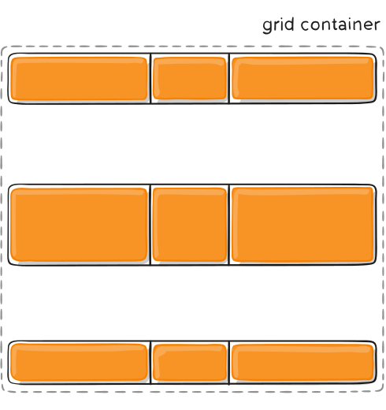
  
- **`space-evenly`**: Distributes equal space around and between grid tracks. 
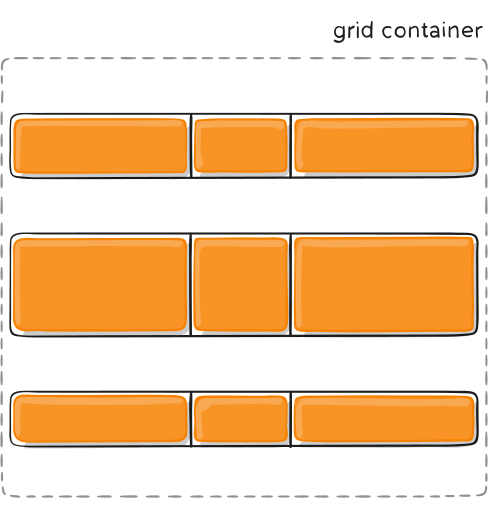
 
#### `place-content`
`place-content` combines `align-content` and `justify-content`:
```
place-content: <align-content> <justify-content>;
```
If only one value is provided, it applies to both **`align-content`** and **`justify-content`**.
#### `grid-auto-columns` and `grid-auto-rows`
`grid-auto-columns` and `grid-auto-rows` size implicit tracks created when placement extends beyond the explicit grid. They accept track sizes like the template properties.
#### `grid-auto-flow`
`grid-auto-flow` controls the direction used to place items that lack explicit positions:
- **`row`**: (Default) Items are placed row by row, filling each row before moving to the next.
- **`column`**: Items are placed column by column, filling each column before moving to the next.
- **`row dense`**: Places by row and backfills earlier gaps when possible. This can make visual order differ from source order.
- **`column dense`**: Places by column and backfills earlier gaps when possible; visual order may differ from source order.
### Cells Properties
#### ``grid-column-start`` and ``grid-column-end``
`grid-column-start` and `grid-column-end` place an item between column lines. Values can be line numbers, line names, spans, or `auto`.
- **`<line-number>`**: Refers to the grid line number (e.g., `1`, `2`, `3`).
- **`<line-name>`**: Refers to a named grid line (if defined in `grid-template-columns`).
- **`span <number>`**: Spans the item across a specified number of columns.
- **`span <name>`**: Spans the item until a named grid line is reached.
- **`auto`**: Lets the grid automatically place the item.  

**Examples :**  
1. **Spanning Specific Columns**:
	```
    grid-column-start: 1;
    grid-column-end: 3;
    ```
	The item starts at column line 1 and ends at column line 3, spanning 2 columns.
2. **Using `span`**:
    ```
    grid-column-start: 2;
    grid-column-end: span 2;
    ```
	The item starts at column line 2 and spans 2 columns.
3. **Named Grid Lines**:
	 ```
    grid-column-start: sidebar-start;
    grid-column-end: main-end;
    ```
    The item starts at the `sidebar-start` line and ends at the `main-end` line (if these lines are defined in `grid-template-columns`).
4. **Automatic Placement**:
    ```
    grid-column-start: auto;
    grid-column-end: auto;
    ```

`grid-column` combines the start and end lines: `grid-column: <start-line> / <end-line>`.
**Example:**  
- **Spanning Specific Columns**:
	 ```
    grid-column: 1 / 3;
	```
	The item starts at column line 1 and ends at column line 3, spanning 2 columns.    
- **Using `span`**:
    
    ```
    grid-column: 2 / span 2;
    ```
     The item starts at column line 2 and spans 2 columns.  
- **Named Grid Lines**:
	```
    grid-column: sidebar-start / main-end;
    ```
     The item starts at the `sidebar-start` line and ends at the `main-end` line (if these lines are defined in `grid-template-columns`).
- **Automatic Placement**:
	```
    grid-column: auto;
    ```
     The grid automatically places the item in the next available column.

#### ``grid-row-start`` and ``grid-row-end``
`grid-row-start` and `grid-row-end` place an item between row lines. They accept line numbers, line names, spans, or `auto`:
- **`<line-number>`**: Refers to the grid line number (e.g., `1`, `2`, `3`).
- **`<line-name>`**: Refers to a named grid line (if defined in `grid-template-rows`).
- **`span <number>`**: Spans the item across a specified number of rows.
- **`span <name>`**: Spans the item until a named grid line is reached.
- **`auto`**: Lets the grid automatically place the item.  
**Examples:**  
1. **Spanning Specific Rows**:
	```
    grid-row-start: 1;
    grid-row-end: 3;
    ```
     The item starts at row line 1 and ends at row line 3, spanning 2 rows.
2. **Using `span`**:
    ```
    grid-row-start: 2;
    grid-row-end: span 2;
    ```
     The item starts at row line 2 and spans 2 rows.  
3. **Named Grid Lines**:
    ```
    grid-row-start: header-start;
    grid-row-end: footer-end;
    ```
     The item starts at the `header-start` line and ends at the `footer-end` line (if these lines are defined in `grid-template-rows`).     
4. **Automatic Placement**:
    ```
    grid-row-start: auto;
    grid-row-end: auto;
    ```
     The grid automatically places the item in the next available row.   

`grid-row` combines the start and end lines: `grid-row: <start-line> / <end-line>`.
**Examples:**  
- **Spanning Specific Rows**:
    ```
    grid-row: 1 / 3;
    ```
     The item starts at row line 1 and ends at row line 3, spanning 2 rows.  
- **Using `span`**:
    ```
    grid-row: 2 / span 2;
    ```
     The item starts at row line 2 and spans 2 rows.    
- **Named Grid Lines**:  
    ```
    grid-row: header-start / footer-end;
    ```
     The item starts at the `header-start` line and ends at the `footer-end` line (if these lines are defined in `grid-template-rows`).   
- **Automatic Placement**:
    ```
    grid-row: auto;
    ```
     The grid automatically places the item in the next available row.
#### ``grid-area``
`grid-area` either names an area from `grid-template-areas` or sets row-start, column-start, row-end, and column-end in that order.
**Syntax:**
```
grid-area: <row-start> / <column-start> / <row-end> / <column-end>;
```
Or  
```
grid-area: <area-name>;
```
#### `justify-self` and `align-self`
`justify-self` and `align-self` override the container’s item alignment for one grid item.
**`justify-self`**:
`justify-self` aligns an item on the inline axis:
- **`start`**: Aligns the item to the left side of the cell.
- **`end`**: Aligns the item to the right side of the cell.
- **`center`**: Centers the item horizontally within the cell.
- **`stretch`**: (Default) Stretches the item to fill the width of the cell.   

**`align-self`**:
`align-self` aligns an item on the block axis:
- **`start`**: Aligns the item to the top of the cell.
- **`end`**: Aligns the item to the bottom of the cell.
- **`center`**: Centers the item vertically within the cell.
- **`stretch`**: (Default) Stretches the item to fill the height of the cell.   
 
`place-self` combines `align-self` and `justify-self`:
**Syntax:**
```
place-self: <align-self> <justify-self>;
```
 If only one value is provided, it applies to both **`align-self`** and **`justify-self`**.
## Responsive design
Responsive design adapts content to available space and user needs. Media queries apply styles when conditions such as viewport width or print output match. A mobile-first base is useful, but choose the starting layout based on the content and project.
### Media queries
Include the viewport meta tag so mobile browsers use the device width as the layout viewport:
```
<meta name="viewport" content="width=device-width, initial-scale=1.0">
```
Create a base layout, then add media queries when content needs a different arrangement. Conditions can use `min-width`, `max-width`, `min-height`, and `max-height`:
- **`min-width`**: Applies styles when the screen width is **greater than or equal to** the specified value.
- **`max-width`**: Applies styles when the screen width is **less than or equal to** the specified value.
- **`min-height`**: Applies styles when the screen height is **greater than or equal to** the specified value.
- **`max-height`**: Applies styles when the screen height is **less than or equal to** the specified value.
#### Example:
**HTML:**
```
<!DOCTYPE html>
<html lang="en">
<head>
    <meta charset="UTF-8">
    <meta name="viewport" content="width=device-width, initial-scale=1.0">
    <title>Responsive Grid Example</title>
    <link rel="stylesheet" href="styles.css">
</head>
<body>
    <div class="grid-container">
        <div class="item">Item 1</div>
        <div class="item">Item 2</div>
        <div class="item">Item 3</div>
        <div class="item">Item 4</div>
    </div>
</body>
</html>
```
**CSS:**
```
.grid-container {
    display: grid;
    gap: 10px;
    padding: 10px;
}

.item {
    background-color: #4CAF50;
    color: white;
    text-align: center;
    padding: 20px;
    font-size: 1.2rem;
    border-radius: 5px;
}

@media (min-width: 600px) {
    .grid-container {
        grid-template-columns: repeat(2, 1fr); /* 2 columns */
    }
}
@media (min-width: 900px) {
    .grid-container {
        grid-template-columns: repeat(4, 1fr); /* 4 columns */
    }
}
```
**Output:**  


Use `@media print` to adjust a page for printed output, for example by hiding navigation and preserving readable text:
```
@media print {
/*
Here Style
*/
}
```
### Best Practices:
#### Start with the content
A mobile-first base often works well: make core content usable in a narrow layout, then enhance it as space allows. It is a design choice, not a requirement for every project.
#### Using Grids
Grid can define responsive columns, gaps, and named areas. Flexible tracks, `minmax()`, and `repeat()` handle many layouts without a media query; use one when the content needs a different arrangement.
#### Choose units by purpose
Use flexible tracks and percentages for proportions, `rem` or `em` for type-related sizing, viewport units for viewport-linked effects, and `px` for small fixed details such as borders. No unit is automatically responsive; choose the reference that matches the design.
#### Using `max-height`, `min-height`, `max-width`, and `min-width` in Responsive Design
Minimum and maximum dimensions set size boundaries while content and available space determine the final size.


**`max-width`**: Caps width, useful for readable text columns and images.


**`min-width`**: Sets a lower size limit. A large minimum can cause overflow on narrow screens.


**`max-height`**: Caps height; consider overflow behavior when content exceeds the cap.


**`min-height`**: Sets a lower height limit while allowing content to grow beyond it.
## Task
Create a responsive restaurant website using **CSS Grid** for layout and **Flexbox** for alignment. The website should adapt to different screen sizes (mobile, tablet, desktop) and include key sections for a restaurant business.
#### Website Sections
Your restaurant website must include the following sections:
1. **Header & Navigation**
	- Restaurant name/logo
	- Navigation menu (Home, Menu, About, Contact)
	- **Mobile-friendly**: Hamburger menu on small screens
2. **Hero Section**
	- Large background image with overlay
	- Call-to-action button (e.g., "View Menu")
	- Centered text using **Flexbox**
3. **Featured Dishes**
	- Grid layout showing 6 dishes
	- Each dish card includes:
	    - Image
	    - Name
	    - Short description
	- **Responsive behavior**:
	    - Mobile: 1 column
	    - Tablet: 2 columns
	    - Desktop: 3 columns
 4. **Menu Section**
	- Grid layout for food items
	- Each item includes:
	    - Image
	    - Name
	    - Price
	    - "Add to Cart" button  
	- Responsive behavior:
	    - Mobile: 1 column
	    - Tablet: 2 columns
	    - Desktop: 3 columns
 5. **Contact Section**
	- Contact form (Name, Email, Message)
	- Embedded Google Map
	- **Responsive behavior**:
	    - Mobile: Form and map stacked
	    - Desktop: Side-by-side
6. **Footer**
	- Opening hours
	- Social media links
	- Copyright information
#### Solution:
You can find our solution here: https://alitigui.github.io/Front_end_solutions/Lecture6/solution/index.html
