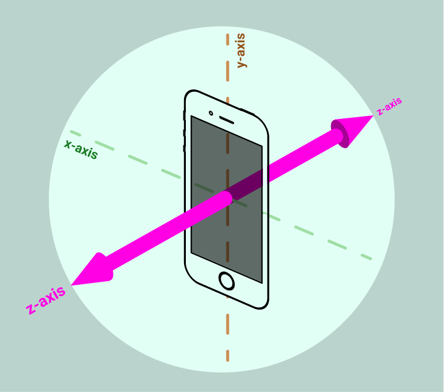
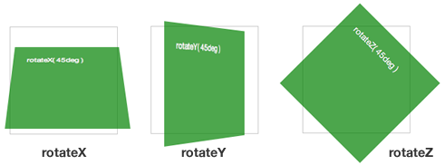
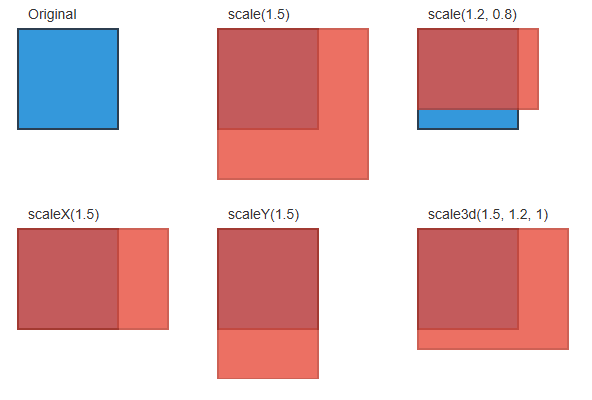
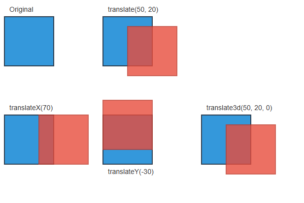
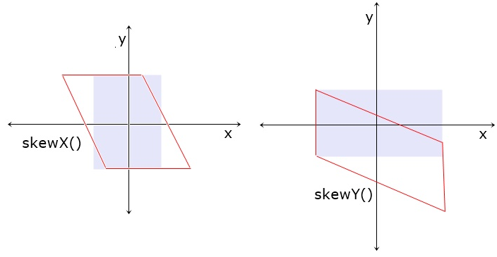

# Lecture 07 — CSS Transforms, Transitions, and Animations

> **Core idea:** Transforms change an element’s rendered geometry; transitions and animations change visual properties over time.

## Learning goals
- Apply 2D and 3D transforms and explain the role of axes and perspective.
- Use transitions to animate a change between property values.
- Define keyframe animations and control their timing and repetition.
## Transforms
The `transform` property rotates, scales, skews, or moves an element in 2D or 3D space. Transforms change the rendered appearance without changing the element’s place in normal flow, so transformed elements can overlap neighbors.
### Axes
In CSS transforms, the axes describe direction:
1. **X-axis**: Represents the **horizontal axis**. Positive values move the element to the right, while negative values move it to the left.
2. **Y-axis**: Represents the **vertical axis**. Positive values move the element downward, while negative values move it upward.
3. **Z-axis**: Represents the **depth axis**, which is perpendicular to the screen. Positive values bring the element closer to the user, while negative values push it farther away. This axis is essential for creating **3D transformations**.  

  

### Perspective
`perspective` on a parent sets the viewer distance for its 3D-transformed children. Larger values create subtler depth; smaller values exaggerate it.
### `transform-style`
`transform-style` controls whether an element’s children keep their 3D positions (`preserve-3d`) or are flattened into the parent’s plane (`flat`, the default).
### Rotate
Rotation functions turn an element around an axis. `rotateZ()` is the usual 2D rotation; `rotateX()` and `rotateY()` produce 3D effects.
- **`rotateX(angle)`**: Rotates the element around the **X-axis** (horizontal axis). 
- **`rotateY(angle)`**: Rotates the element around the **Y-axis** (vertical axis). 
- **`rotateZ(angle)`**: Rotates the element around the **Z-axis** (depth axis). 
#### Example
```
div {
  transform: rotateZ(180deg);
}
```
This rotates the `<div>` by 180 degrees around the Z-axis.

  

### Scale
`scale()` resizes an element around its transform origin. One value scales both axes; two values set horizontal and vertical scale separately.
```
transform: scale(1.5);
```
```
transform: scale(1.2, 0.8);
```
Use `scaleX()` or `scaleY()` to affect one axis:
```
transform: scaleX(2);
```
```
transform: scaleY(0.5);
```
For 3D scaling, `scale3d()` takes x, y, and z ratios; `scaleZ()` changes only the z-axis scale.
```
transform: scale3d(1.5, 1.2, 2);
```

  

### Translate
`translate()` moves an element. Its first two values set x and y; `translateX()` or `translateY()` moves along one axis:
```
transform: translate(50px, 20px);
```
```
transform: translateX(100px);
```
```
transform: translateY(-30px);
```
For 3D movement, `translate3d()` takes x, y, and z distances; `translateZ()` changes depth alone:
- **First value**: Movement along the **X-axis**.
- **Second value**: Movement along the **Y-axis**.
- **Third value**: Movement along the **Z-axis** (depth).

  
 
### Skew
`skew()` slants an element. Its values set the x and y angles; `skewX()` and `skewY()` affect one axis.
```
transform: skew(20deg, -15deg);
```
    

## Transitions and Animations
### Introduction
CSS transitions animate property changes between states. CSS animations follow keyframes over time and can run independently of a hover or focus state.
### Transition
Use transitions for a change between two states. The main properties are:
1. `transition-property`: Specifies the CSS properties to which the transition effect should be applied (e.g., `background-color`, `opacity`, `transform`).
2. `transition-duration`: Defines how long the transition lasts (e.g., `1s`, `500ms`).
3. `transition-timing-function`: Specifies the speed curve of the transition (e.g., `ease`, `linear`, `ease-in-out`).
	- **`ease`**: The default value. The transition starts slowly, accelerates in the middle, and slows down at the end. This is the most commonly used timing function.
	- **`linear`**: The transition occurs at a constant speed from start to end. There is no acceleration or deceleration.
	- **`ease-in`**: The transition starts slowly and accelerates as it progresses.
	- **`ease-out`**: The transition starts quickly and slows down as it progresses.
	- **`cubic-bezier(x1, y1, x2, y2)`**: Defines a custom timing curve.
	- **`steps(n, start|end)`**: Divides the change into discrete steps.
4. `transition-delay`: Adds a delay before the transition starts (e.g., `0.5s`).

**Example**  
**HTML**
```
<div class="box"></div>
```
**CSS**
```
    .box {
      width: 150px;
      height: 150px;
      background-color: blue;
      border-radius: 10px;
      margin: 50px auto;
      transition-property: background-color, transform, opacity;
      transition-duration: 1s, 0.5s, 2s;
      transition-timing-function: ease-in-out, linear, ease;
      transition-delay: 0.2s, 0s, 0.5s;
    }

    .box:hover {
      background-color: red; 
      transform: rotate(45deg) scale(1.2);
      opacity: 0.7;
    }
```
**What happens:** Hovering changes three properties. Their durations, timing curves, and delays are listed in the same order as `transition-property`.
Keep transitions focused on the properties that need to change. Respect the user’s reduced-motion preference when motion is not essential:
```
@media (prefers-reduced-motion: reduce) {
  .animated-element {
    animation: none;
    transition: none;
  }
}
```
#### Using `transition`
The `transition` shorthand combines property, duration, timing function, and delay:
```
transition: opacity 200ms ease-in-out 0s;
```
**Example:**  
**HTML**
```
  <div class="box"></div>
```
**CSS**
```
    .box {
      width: 150px;
      height: 150px;
      background-color: blue;
      border-radius: 10px;
      margin: 50px auto;
      transition: background-color 1s ease-in-out 0.2s,
                  transform 0.5s linear 0s,
                  opacity 2s ease 0.5s;
    }

    .box:hover {
      background-color: red; 
      transform: rotate(45deg) scale(1.2);
      opacity: 0.7; 
    }
```
### Animation
Use `@keyframes` to define how properties change over an animation’s timeline, then configure the animation on an element.
#### Animation properties

| Property | Purpose and common values |
|---|---|
| `animation-name` | Selects a named `@keyframes` rule. |
| `animation-duration` | Sets one cycle’s duration, such as `2s` or `500ms`. |
| `animation-timing-function` | Controls pacing with values such as `ease`, `linear`, or `ease-in-out`. |
| `animation-delay` | Waits before the first cycle starts. |
| `animation-iteration-count` | Sets the number of cycles or `infinite`. |
| `animation-direction` | `normal` plays forward, `reverse` backward, `alternate` switches direction each cycle, and `alternate-reverse` starts backward. |
| `animation-fill-mode` | `none` applies no keyframe styles outside playback; `forwards` keeps the final keyframe; `backwards` applies the initial keyframe during a delay; `both` combines backwards and forwards. |
| `animation-play-state` | `running` plays; `paused` pauses at the current point. |

The `animation` shorthand combines these properties:
```
animation: bounce 1s ease-in-out 0s infinite alternate both running;
```
#### `@keyframes`
Name a `@keyframes` rule to match `animation-name`, then define styles at timeline points:
- `0%` represents the **starting point** of the animation.       
- `50%` represents the **midpoint**.       
- `100%` represents the **ending point**.  

Each percentage specifies the styles at that point; the browser interpolates between compatible values.
#### Example 
Bouncing ball    
**HTML**
```
<div class="ball"></div>
```
**CSS**
```
.ball {
  width: 50px;
  height: 50px;
  background-color: red;
  border-radius: 50%;
  animation: bounce 1s ease-in-out infinite alternate;
}

@keyframes bounce {
  0% {
    transform: translateY(0);
  }
  100% {
    transform: translateY(-100px);
  }
}
```
## Task:
Create a responsive portfolio website showcasing your work using modern CSS techniques. Demonstrate your skills in layout design, responsiveness, and visual effects.
#### Requirements
1. **Core Structure**
- Use CSS Grid for main layout with `grid-template-areas`
- Implement Flexbox for component alignment
- Follow mobile-first approach with three breakpoints:
    - Mobile (<768px): Single column
    - Tablet (768-1023px): Two columns
    - Desktop (≥1024px): Multi-column
#### Required Sections
1. **Header**: Logo + responsive navigation (hamburger menu on mobile)
2. **Hero**: Introduction with call-to-action button
3. **Projects**: Responsive grid of work samples
4. **Skills**: Flexbox-based display of abilities
5. **Contact**: Functional form
6. **Footer**: Social links + copyright
#### Visual Enhancements
- Gradient backgrounds
- Smooth hover animations
- Transform effects (scale/rotate)
- Page load animations (optional)
#### Solution:
You can find our solution here: https://alitigui.github.io/Front_end_solutions/Lecture7/solution/index.html
