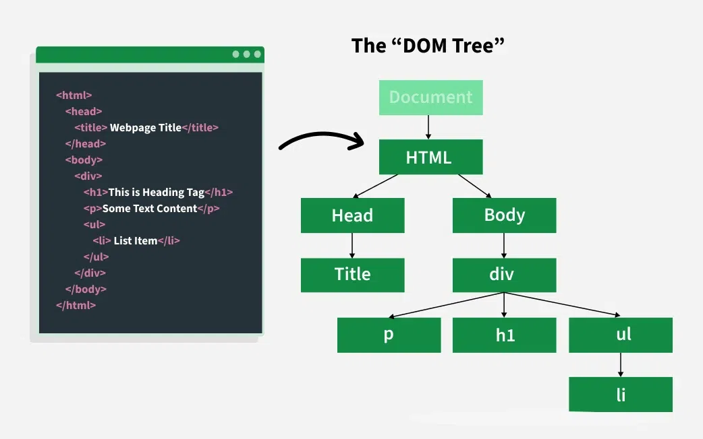

# Lecture 12 — The DOM, Browser APIs, and Real-Time Data

> **Core idea:** Browser APIs connect JavaScript to the page, browser state, and live communication; event-driven code responds to changes over time.

## Learning goals
- Select DOM nodes, change content and attributes, and respond to user events.
- Use browser APIs and client-side storage for appropriate kinds of state.
- Describe how a WebSocket connection supports two-way real-time messaging.
## DOM manipulation
The **Document Object Model (DOM)** represents a document as connected nodes and objects. JavaScript can select those nodes, read or update content and attributes, respond to events, and create or remove elements.
  

### Adding JavaScript to a page
For small examples, place code in a `<script>` element:
```
<script>
  // JavaScript code goes here
  alert("This is an internal script!");
  console.log("Executed directly in HTML");
</script>
```
For reusable code, load an external file. Use `defer` when a classic script should run after HTML parsing:
```
<script src="scripts/main.js" defer></script>
```
### Selecting elements
Choose a selector that matches the number of elements you need:
#### By tag name
`getElementsByTagName()` returns a live `HTMLCollection`; it updates as matching elements are added or removed.
```
// Select all <div> elements
const divElements = document.getElementsByTagName('div');
```
#### By class name
`getElementsByClassName()` also returns a live `HTMLCollection`.
```
// Select all elements with 'menu-item' class
const menuItems = document.getElementsByClassName('menu-item');
```
#### By ID
`getElementById()` returns the matching element or `null`. Keep IDs unique in the document.
```
// Select element with ID "header"
const headerElement = document.getElementById('header');
```
#### CSS Selectors
CSS selector methods offer more flexible matching:
1. **First match**
```
// Select first <button> with class "primary"
const btn = document.querySelector('button.primary');
```
2. **All matches**
```
// Select all <input> elements with type "text"
const textInputs = document.querySelectorAll('input[type="text"]');
```
### Manipulating DOM Elements
After selecting a node, you can update its content, style, attributes, and classes.
#### Changing Element Content
1. `innerHTML` parses and replaces an element’s markup. Use it only with trusted or safely sanitized HTML; use `textContent` for plain text.
```
const element = document.querySelector('#target');
element.innerHTML = '<strong>New</strong> content';
```
2. `textContent` sets plain text without parsing it as HTML.
```
const element = document.querySelector('#target');
element.textContent = 'Plain text content';
```
3. `value` reads or sets a form control’s value. It is usually a string.
```
const element = document.querySelector('#target');
element.value = 'New input value';
```
#### Changing Element Style
For one-off changes, `style` sets inline CSS properties:
```
const element = document.querySelector('#target');
element.style.backgroundColor = 'blue';
element.style.fontSize = '1.2rem';
```
`cssText` replaces the element’s entire inline style declaration. For reusable states, prefer adding a CSS class with `classList`.
```
const element = document.querySelector('#target');
element.style.cssText = `
  color: white;
  padding: 1rem;
  display: flex;
`;
```
#### Managing Attributes
Read or update attributes and reflected properties:
1. Properties such as `link.href` may return a resolved URL; `getAttribute()` returns the attribute’s written value.
```
const link = document.querySelector('a');
const href = link.href; 
const title = link.getAttribute('title');
```
2. `attributes` exposes the element’s attribute collection.
```
const attributes = document.getElementById('myElement').attributes;
```
3. Set or update attributes
```
const img = document.querySelector('img');

img.setAttribute('alt', 'Description of image');
img.src = 'new-image.jpg';
```
4. Form control state is available through properties such as `value` and `checked`:
```
const input = document.querySelector('input[type="text"]');
const checkbox = document.querySelector('input[type="checkbox"]');

// Current value (always returns string)
const value = input.value;

// For checkboxes/radio buttons
const isChecked = checkbox.checked;
```
5. Use `classList` to inspect and update classes:
```
const div = document.getElementById('container');

// Get all classes
const classList = div.classList;

// Check for class
const hasClass = div.classList.contains('active');

// Add class
div.classList.add('highlight');

// Remove class
div.classList.remove('old-style');

// Replace all classes
div.className = 'new-class another-class';
```
#### Removing Elements
We can remove an element from the DOM by using the `.remove()` method.
```
const element = document.querySelector('#target');
element.remove();
```
### Event handling
An event listener runs a callback when an event occurs, such as a click, input change, or key press. `addEventListener()` takes the event type and the callback:
```
const button = document.querySelector('#myButton');

button.addEventListener('click', function() {
  // Code to execute when button is clicked
  console.log('Button was clicked!');
});
```
#### Common Event Types

|Event|Description|
|---|---|
|`click`|Mouse click|
|`input`|Form field changes|
|`keydown`|Keyboard key press|
|`scroll`|Page/element scrolling|
|`mouseover`|Mouse pointer enters element|


### Creating and inserting elements
Use `document.createElement()` to create a node, then set its content and attributes:
```
// Create a new div
const newDiv = document.createElement('div');

// Create a paragraph
const newParagraph = document.createElement('p');
```
#### Setting up the elements
```
// Add text content
newParagraph.textContent = 'This is our new paragraph';

// Add a class
newDiv.className = 'container';

// Style it
newDiv.style.backgroundColor = '#f0f0f0';
```
#### Inserting elements
Insertion methods place a node relative to a parent or another node:

| Method                       | What It Does                                  | Example                               |
| ---------------------------- | --------------------------------------------- | ------------------------------------- |
| `append()`                   | Adds to the end                               | `parent.append(newDiv)`               |
| `prepend()`                  | Adds to the start                             | `parent.prepend(newDiv)`              |
| `before()`                   | Puts before another                           | `element.before(newDiv)`              |
| `after()`                    | Puts after another                            | `element.after(newDiv)`               |
| `insertBefore()` | Inserts a node before a specified child node. | `parent.insertBefore(newDiv, referenceNode)` |
| `replaceChild()` | Replaces one child node with another. | `parent.replaceChild(newDiv, oldDiv)` |


```
const container = document.querySelector('#container');
const newDiv = document.createElement('div');
const newParagraph = document.createElement('p');
newParagraph.textContent = 'This is a new paragraph';
newDiv.className = 'container';
newDiv.append(newParagraph);
newDiv.style.backgroundColor = '#f0f0f0';
container.append(newDiv);
const oldItem = document.querySelector('.old');
const replacement = document.createElement('p');
replacement.textContent = 'Updated item';
oldItem.replaceWith(replacement);
```
`insertAdjacentHTML()` can insert a markup string, but only use trusted or sanitized HTML. For untrusted text, create an element and set `textContent`.
#### Cloning an element
`cloneNode(true)` copies the node and its descendants. It does not copy listeners registered with `addEventListener`; update duplicate IDs before insertion.
```
const original = document.querySelector('.template');
const copy = original.cloneNode(true); 

copy.id = 'new-copy';
document.body.append(copy);
```
## Browser APIs and client-side storage
### Browser APIs
**Browser Object Model (BOM)** is an informal name for browser APIs outside the document tree. The DOM models the page; objects on `window` expose browser features such as:
- `window`: Represents the browser window or frame.
- `document`: Represents the HTML document loaded in the browser.
- `navigator`: Exposes browser capabilities and environment information, subject to privacy limits.
- `location`: Reads the current URL and can navigate to another URL.
- `history`: Interacts with the current tab’s session history.
### Accessing browser APIs
In browser scripts, `window` is the global object. Use it explicitly when it makes the source of an API clearer.
#### Accessing the Window Object
```
console.log(window.innerWidth); // Width of the window 
console.log(window.innerHeight); // Height of the window
```
#### Using the Location Object
```
console.log(window.location.href); // Access the current URL   
window.location.href = "https://www.example.com"; // Change the current URL 
```
## Client-side data storage
Browsers can store data on the user’s device. Choose storage by lifetime and access needs; client-side data is accessible to scripts running on the origin, so do not store secrets in Web Storage.
### JSON
**JSON (JavaScript Object Notation)** is a text format commonly used to exchange structured data between clients and servers.
#### JSON Structure
A JSON object is a collection of key-value pairs, similar to JavaScript objects. However, in JSON:
- Keys must be strings enclosed in double quotes.
- Values can be strings, numbers, arrays, booleans, or other objects.
```
{
  "name": "John Doe",
  "age": 30,
  "isStudent": false,
  "address": {
    "street": "123 Main St",
    "city": "Anytown"
  },
  "courses": ["Math", "Science", "History"]
}
```
#### Converting Between JSON and JavaScript Objects
Use `JSON.parse()` to turn JSON text into JavaScript values and `JSON.stringify()` to serialize supported values. Parsing can throw for invalid JSON; validate untrusted data after parsing.
**Parsing JSON (String to Object)**  
Parse JSON text into a JavaScript value:
```
const jsonString = '{"name": "John", "age": 30}'; 
const jsonObject = JSON.parse(jsonString); 
console.log(jsonObject.name); // Output: John
```
**Converting to JSON (Object to String)**  
Serialize a JavaScript value to JSON text:
```
const user = { name: "John", age: 30 }; 
const jsonString = JSON.stringify(user); 
console.log(jsonString); // Output: '{"name":"John","age":30}'
```
### Cookies
Cookies are small values that the browser can attach to matching HTTP requests. They are useful for server-managed sessions and preferences, but settings such as `Secure`, `HttpOnly`, and `SameSite` matter for security. JavaScript cannot read or set the `HttpOnly` flag; configure it in the server’s `Set-Cookie` response.
```
// Set a readable preference cookie for one day
document.cookie = "theme=dark; Max-Age=86400; Path=/; SameSite=Lax; Secure";

// Access cookies from the document
console.log(document.cookie);

// Delete it by setting its max age to zero
document.cookie = "theme=; Max-Age=0; Path=/; SameSite=Lax; Secure";
```
### LocalStorage
`localStorage` stores string key-value pairs for an origin and persists across browser restarts until removed. It is synchronous, may be unavailable or quota-limited, and should not hold sensitive data.
#### Storing Data in LocalStorage
```
// Store data in LocalStorage 
localStorage.setItem('username', 'JohnDoe');
```
#### Retrieving Data from LocalStorage
```
// Retrieve data from LocalStorage 
const username = localStorage.getItem('username'); 
console.log(username); // Output: JohnDoe
```
#### Removing Data from LocalStorage
```
// Remove data from LocalStorage 
localStorage.removeItem('username');
```
#### Clearing All Data from LocalStorage
```
// Clear all data from LocalStorage 
localStorage.clear();
```
### SessionStorage
`sessionStorage` also stores strings by origin, but is scoped to a page session in a tab and is cleared when that session ends. A new tab generally has a separate storage area.
#### Storing Data in SessionStorage
```
// Store data in SessionStorage 
sessionStorage.setItem('sessionID', 'abc123');
```
#### Retrieving Data from SessionStorage
```
// Retrieve data from SessionStorage 
const sessionID = sessionStorage.getItem('sessionID'); 
console.log(sessionID); // Output: abc123
```
#### Removing Data from SessionStorage

```
// Remove data from SessionStorage 
sessionStorage.removeItem('sessionID');
```
#### Clearing All Data from SessionStorage
```
// Clear all data from SessionStorage 
sessionStorage.clear();
```
### URL encoding and Blobs
URL encoding escapes data for a URL component; a **Blob** represents raw data for file and binary APIs. They solve different problems.
#### URL Encoding
Percent encoding represents bytes that cannot appear literally in a URL component using `%` followed by hexadecimal digits.
For example:
- A space character becomes `%20`
- An ampersand `&` becomes `%26`  

Use `encodeURIComponent()` for a component such as a query parameter value, not for an entire URL:
#### Encoding a URL component
```
const name = "John Doe & Co."; 
const encodedName = encodeURIComponent(name); 
console.log(encodedName); // Output: John%20Doe%20%26%20Co.
```
#### Decoding a URL component
Use `decodeURIComponent()` to decode a component. It throws if the input contains malformed percent-encoding.
```
const encodedName = "John%20Doe%20%26%20Co."; 
const decodedName = decodeURIComponent(encodedName); 
console.log(decodedName); // Output: John Doe & Co.
```
#### Using Blobs
A **Blob** represents immutable raw data, such as text or binary file contents. Browser APIs can read it or create an object URL for it.
#### Creating a Blob from Data
Create a Blob from data parts and an optional MIME type:
```
const textData = "Hello, this is some text content!"; 
const blob = new Blob([textData], { type: 'text/plain' });
console.log(blob.type, blob.size); // text/plain and the size in bytes
```
#### Downloading Text Files with Blobs
Create an object URL, use it as a download link, then release it after the browser has had time to start the download:
```
const textData = "This is the content of my text file."; 
const blob = new Blob([textData], { type: 'text/plain' }); 
const url = URL.createObjectURL(blob);
const link = document.createElement('a'); 
link.href = url; 
link.download = 'file.txt';
document.body.append(link);
link.click();
link.remove();
setTimeout(() => URL.revokeObjectURL(url), 1000);
```
#### Reading Blobs with FileReader
`FileReader` reads a Blob asynchronously. For text, `blob.text()` is a promise-based alternative.
```
const blob = new Blob(['Hello, world!'], { type: 'text/plain' }); 
const reader = new FileReader();  
reader.onload = function(event) {  
console.log(event.target.result); // Output: Hello, world! 
};  
reader.readAsText(blob);
```
#### URL encoding and Blob compared
| Feature         | URL Encoding                    | Blob                    |
| --------------- | ------------------------------- | ----------------------- |
| **Data type** | Text encoded as a URL component | Immutable text or binary data |
| **Use case** | Query parameter or path value | File and binary APIs, downloads |
| **Size** | Keep URLs within server and browser limits; limits vary | Can represent larger data, subject to memory and browser limits |
| **Cleanup** | No object URL to release | Revoke object URLs after use |
| **Read back** | `decodeURIComponent()` | `blob.text()` or `FileReader` |


## WebSockets and real-time data
### Introduction
HTTP request–response works well when the client asks for data. For ongoing two-way messaging, a **WebSocket** opens a persistent full-duplex connection after an HTTP-based handshake. Either side can send messages while it remains open.
```
const socket = new WebSocket('wss://your-websocket-server.example/socket');

socket.addEventListener('open', () => {
  console.log('WebSocket connection opened');
  socket.send('Hello Server!');
});

socket.addEventListener('message', (event) => {
  console.log('Message from server:', event.data);
});

socket.addEventListener('close', () => {
  console.log('WebSocket connection closed');
});
```
### How WebSockets Work
1. The client (browser) initiates a WebSocket connection using the `WebSocket` object.
2. The connection is established with a WebSocket server.
3. Messages can then be sent and received in real time.
4. Either side can close the connection when it’s no longer needed.
### Creating a WebSocket Connection
Create a `WebSocket` with the server URL. Replace the placeholder with an endpoint that runs a WebSocket server:
```
const socket = new WebSocket('wss://example.com/socket');
```
- Use `wss://` for a TLS-protected connection, usually from an HTTPS page.
- Use `ws://` only for an unencrypted connection, such as local development.
### Listening for WebSocket Events
Listen for these lifecycle and message events:

|Event|Description|
|---|---|
|`open`|Triggered when the connection opens|
|`message`|Triggered when a message is received|
|`error`|Triggered when an error occurs|
|`close`|Triggered when the connection closes|


```
socket.addEventListener('open', () => {
  console.log('Connected to server');
});

socket.addEventListener('message', (event) => {
  console.log('Received:', event.data);
});

socket.addEventListener('error', (event) => {
  console.error('WebSocket connection error:', event);
});

socket.addEventListener('close', () => {
  console.log('Connection closed');
});
```
### WebSocket methods and state

|**Component**|**Description**|
|---|---|
|`new WebSocket(url)`|Creates a new WebSocket instance|
|`send(data)`|Sends a string or binary data such as a `Blob` or `ArrayBuffer`; call it only after the connection opens|
|`close()`|Terminates the connection|


#### Example
```
const chatSocket = new WebSocket('wss://your-websocket-server.example/chat');
const sendButton = document.getElementById('sendBtn');
sendButton.disabled = true;

chatSocket.addEventListener('open', () => {
  sendButton.disabled = false;
});

chatSocket.addEventListener('close', () => {
  sendButton.disabled = true;
});

chatSocket.addEventListener('message', (event) => {
  const messageBox = document.getElementById('chat');
  const msg = document.createElement('p');
  msg.textContent = event.data;
  messageBox.appendChild(msg);
});

document.getElementById('sendBtn').addEventListener('click', () => {
  const input = document.getElementById('messageInput');
  const message = input.value.trim();
  if (chatSocket.readyState !== WebSocket.OPEN || !message) return;
  chatSocket.send(message);
  input.value = '';
});
```
Close a connection when it is no longer needed. Production applications also need reconnection, authentication, message validation, and a plan for slow consumers.
```
chatSocket.close()
```
## Task
### Objective
Create a responsive Todo List application that:
- Uses **DOM manipulation** to add, edit, and delete tasks
- Saves tasks to **localStorage** for persistence
- Allows exporting/importing tasks as **JSON files**
- Implements **modern CSS** (Grid, Flexbox, Animations)
- Follows **OOP principles** and uses **async operations**
### Requirements
#### Core Functionality
- Add new tasks with titles, descriptions, and due dates
- Mark tasks as complete/incomplete
- Edit existing tasks
- Delete tasks
- Filter tasks (All/Active/Completed)
#### Data Persistence
- Automatically save tasks to **localStorage**
- Load tasks from localStorage on page refresh
- **Export tasks** as a JSON file (using Blobs)
- **Import tasks** from a JSON file (using FileReader)
#### UI/UX Features
- **Responsive layout** (works on mobile/desktop) using:
    - CSS Grid for main structure
    - Flexbox for task items
- **Animations**:
    - Smooth transitions when adding/removing tasks
    - Hover effects on buttons
- **Visual feedback**:
    - Gradient backgrounds
    - Transform effects (e.g., scale on hover)
#### Advanced JavaScript
- Use **OOP** (Classes) to manage tasks
- Implement **async/await** for file operations
- **Error handling** for file imports
### Solution:
You can find our solution here: https://alitigui.github.io/Front_end_solutions/Lecture12/Solution/index.html
